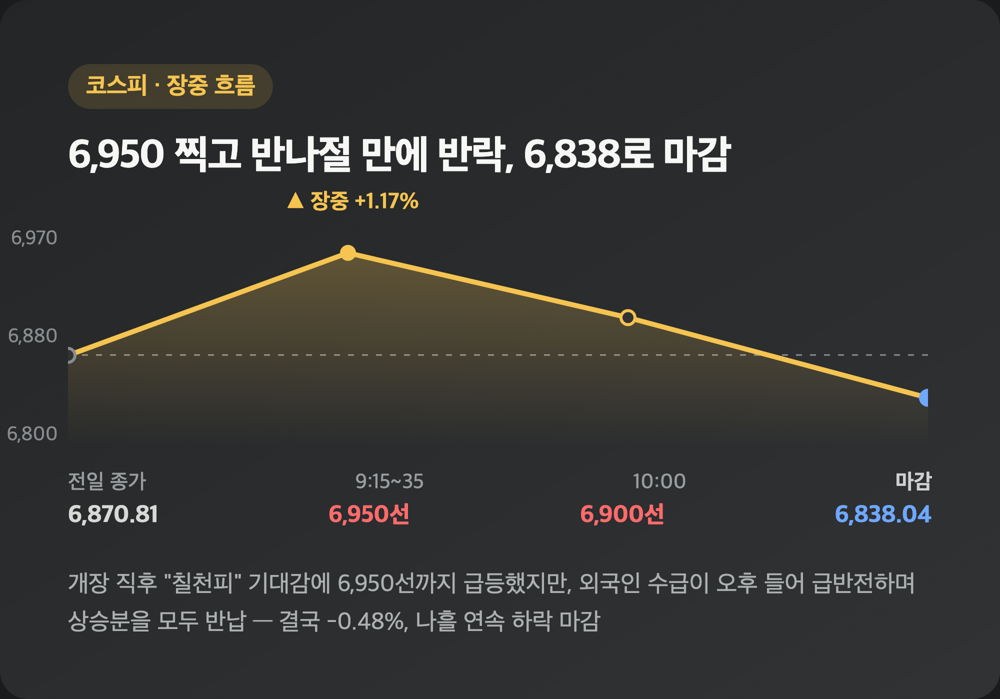
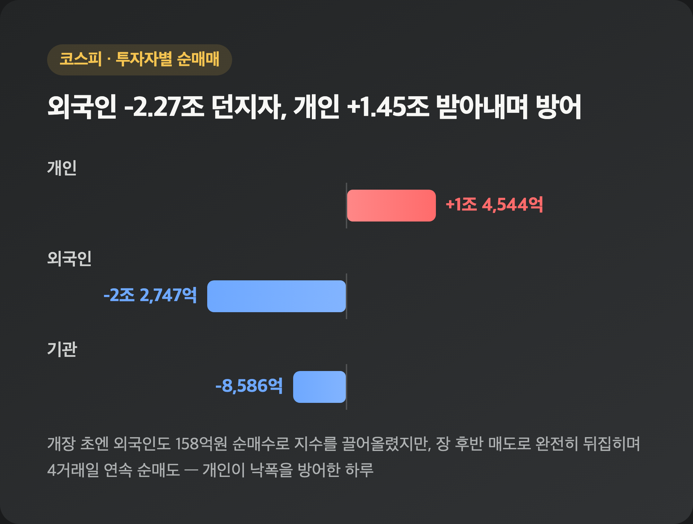
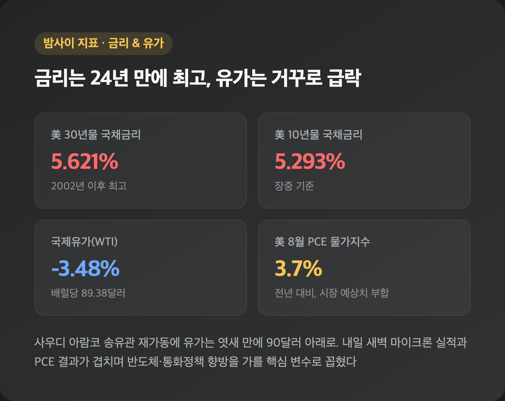
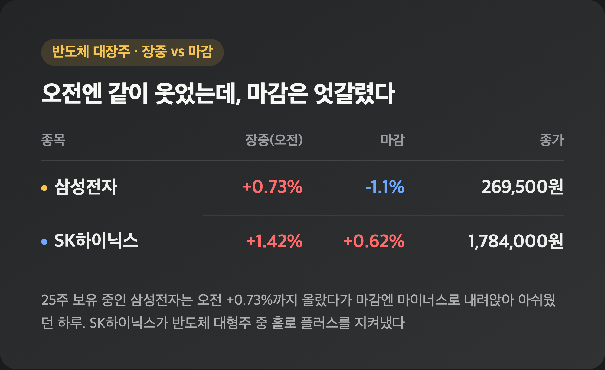
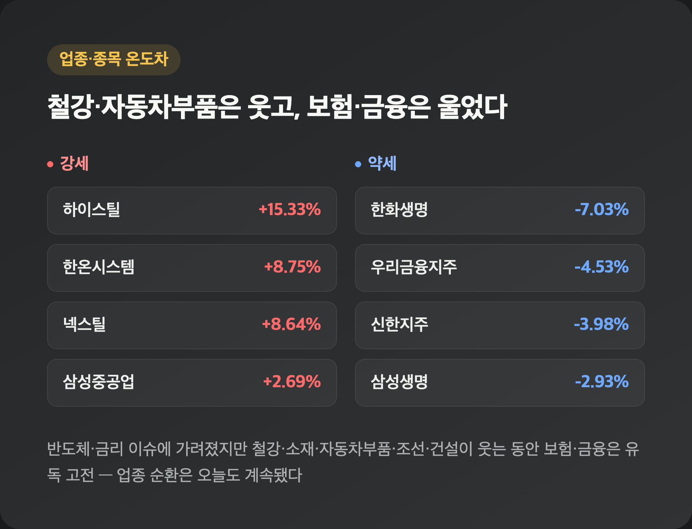

# [내일도 주린이] 코스피 장중 6,950 찍고도 나흘째 하락…코스닥은 855선 홀로 상승 (9/30)

와, 오늘 국장 진짜 롤러코스터였어요. 장 초반엔 코스피가 80포인트 넘게 튀어 오르면서 "오 이러다 칠천피 다시 가나" 싶었는데, 오후 들어 그 상승분을 싹 반납하고 결국 나흘 연속 하락으로 마감했습니다. 오늘은 이 극적인 반전부터 순서대로 풀어볼게요.

---

## 🇰🇷 코스피 6,838.04 마감 – 장중 6,950 찍고 반나절 만에 반락

> **코스피 6,838.04 (-32.77, -0.48%) / 코스닥 855.91 (+6.11, +0.72%)**

| 시점 | 코스피 | 비고 |
|---|---|---|
| 개장 직후(9:15~35) | 6,950선 | +0.97%~+1.17% 급등, "칠천피" 기대감 |
| 오전 10시 | 6,900선 | 반도체 강세에 힘입어 상승 유지 |
| 최종 마감 | 6,838.04 | -0.48%, 나흘 연속 하락 |

코스닥은 반대로 갔어요. 전일 대비 +0.72% 오른 855.91로 마감하면서 코스피와 또 한번 엇갈렸습니다. 저는 오전에 코스피 6,900선 회복했다는 소식 보고 "오늘은 좀 편하게 넘어가나" 했는데, 장 후반에 이게 통째로 뒤집히는 걸 보면서 "이게 뭔 상황이지" 싶었어요. 장중 상승분을 다 반납한 배경엔 아래에서 다룰 외국인 수급 급반전이 있었습니다.

---

## 💰 외국인, 오전엔 사고 오후엔 던졌다 – 코스피 수급 급반전

> **코스피: 개인 +1조 4,544억원 / 외국인 -2조 2,747억원 / 기관 -8,586억원**

| 투자자 | 코스피 순매매 | 코스닥 순매매 |
|---|---|---|
| 개인 | +1조 4,544억원 | -20억원 |
| 외국인 | -2조 2,747억원 | -664억원 |
| 기관 | -8,586억원 | +561억원 |

재밌는 건 이 수치가 장중 흐름과는 정반대였다는 거예요. 개장 초(9시대)엔 외국인이 오히려 158억원 순매수 중이었고, 오전 10시까지도 SK하이닉스 등 반도체 중심으로 매수를 이어가며 지수를 끌어올렸거든요. 그런데 장 후반 들어 매매 방향이 완전히 뒤집히면서 최종적으로는 외국인이 2조 2,747억원을 팔아치웠습니다. 이걸로 외국인은 4거래일 연속 순매도를 이어갔고요. 개인이 1조 4,544억원을 받아내며 낙폭을 방어했으니, 오늘도 개인 투자자들이 방파제 역할을 톡톡히 한 셈이에요.

---

## 📊 美 금리 5%대 고공행진에도 유가는 급락 – PCE·마이크론 실적 예고

> **美 30년물 국채금리 장중 5.621% (2002년 이후 최고) / 10년물 장중 5.293% / WTI -3.48%**

| 이슈 | 내용 |
|---|---|
| 美 30년물 국채금리 | 장중 5.621%, 2002년 이후 24년 만에 최고 |
| 美 10년물 국채금리 | 장중 5.293% |
| 국제유가(WTI) | 전일 대비 -3.48%, 배럴당 89.38달러(엿새 만에 90달러 아래) |
| 美 8월 PCE 물가지수 | 전년 대비 3.7%(시장 예상치와 일치) |

간밤 미국 장기금리가 또 한 번 24년 만의 최고 수준까지 치솟았는데, 유가는 오히려 급락했어요. 사우디 아람코가 드론 공격으로 멈췄던 송유관 가동을 재개한 게 배경으로 꼽혔습니다. 이날 밤엔 미국 8월 PCE 물가지수가 예상치와 정확히 일치하는 3.7%로 나왔고, 내일(10/1) 새벽엔 마이크론 실적 발표까지 예정돼 있어서 대신증권 이경민 연구원은 이 두 이벤트를 "연방준비제도의 통화정책 경로와 AI·반도체 업종의 모멘텀을 가늠할 핵심 이벤트"로 꼽았어요. 오전 반도체주 강세도 사실 이 마이크론 실적 기대감이 배경이었다고 하니, 내일 새벽 결과가 꽤 중요할 것 같습니다. 참고로 원/달러 환율은 전일 대비 3.9원 내린 1,352.8원으로 소폭의 원화 강세가 이어졌어요.

---

## 💾 삼성전자 -1.1% vs SK하이닉스 +0.62% – 장중엔 같이 웃었는데 마감은 갈렸다

> **삼성전자 269,500원(-1.1%~-1.47%) / SK하이닉스 1,784,000원(+0.62%~1.08%)**

| 종목 | 장중(오전 기준) | 마감 | 거래대금 |
|---|---|---|---|
| 삼성전자 | +0.73% | -1.1%~-1.47% | 약 1조 9,537억원 |
| 삼성전자우 | - | -3.41%(197,050원) | - |
| SK하이닉스 | +1.42%~+2.78% | +0.62%~1.08% | 약 2조 7,785억원 |

삼성전자 등락률은 매체별로 -1.1%와 -1.47%로 소폭 다르게 나왔고, SK하이닉스도 +0.62%부터 +1.08%까지 제각각이었는데요(계산 기준 시점 차이로 추정돼요), 방향성은 삼성전자 하락·SK하이닉스 상승으로 다들 일치했습니다. 25주 들고 있는 삼성전자 입장에선 오전엔 +0.73%까지 오르면서 "오늘은 좀 오르나" 기대했는데 마감엔 다시 마이너스로 내려앉아서 살짝 아쉬웠어요. 그래도 SK하이닉스가 반도체 대형주 중 홀로 플러스를 지켜낸 걸 보면, 내일 마이크론 실적 나오기 전까지는 반도체 업종 자체에 대한 기대감은 아직 살아있는 것 같습니다.

---

## ⚙️ 철강·자동차부품은 웃고, 보험·금융은 울었다 – 업종별 온도차

> **하이스틸 +15.33% / 한온시스템 +8.75% / 한화생명 -7.03%**

| 강세 업종·종목 | 등락률 | 약세 업종·종목 | 등락률 |
|---|---|---|---|
| 하이스틸 | +15.33% | 한화생명 | -7.03% |
| 넥스틸 | +8.64% | 우리금융지주 | -4.53% |
| 한온시스템 | +8.75% | 신한지주 | -3.98% |
| 삼성중공업 | +2.69% | KB금융 | -2.71% |
| 대우건설 | +2.3% | 삼성생명 | -2.93% |

코스닥 쪽에서는 반도체 장비주가 강세를 보이면서 지수 상승을 견인했어요. 주성엔지니어링(+4.73%), 이오테크닉스(+4.94%), HPSP(+4.43%) 같은 종목들이 대표적이고요. 중소형주 중에는 KBI동양철관이 1,720만주 넘게 거래되며 상한가를 찍었고, 부산주공은 +48.65% 급등했습니다. 업종별로 보면 철강·소재·자동차부품·조선·건설이 웃는 동안 보험·금융이 유독 고전했는데, 저는 이걸 보면서 "오늘 반도체·금리 얘기에 가려졌지만 업종 순환은 계속 도는구나" 싶었어요.

---

## 🔮 다음 변수 – 마이크론 실적, ISM 제조업지수, 美 고용보고서

> **10/1 새벽 마이크론 FY4분기 실적 / 10/1 美 ISM 제조업지수 / 10/2 美 9월 비농업 고용보고서**

| 일정 | 내용 |
|---|---|
| 9/30 밤(현지)~10/1 새벽(한국시간) | 마이크론테크놀로지 FY4분기 실적 발표(옵션시장은 주가 최대 ±7.8% 변동 전망) |
| 10/1 | 美 9월 ISM 제조업지수 발표 |
| 10/2 | 美 9월 비농업 고용보고서(고용 증가폭 68.3만~70.6만명 예상) |

대신증권 이경민 연구원은 10월 코스피 밴드로 6,500~7,200선을 제시하면서 "금리를 이길 수 있는 모멘텀이 무엇이냐"가 관건이라고 짚었어요. 유가·금리가 안정되고 3분기 실적이 예상보다 좋으면 상승 탄력이 붙을 거라는 설명입니다. 한편 앤트로픽이 IPO 투자설명서에서 향후 10년간 최소 5,180억달러 규모의 AI 인프라 투자 계획을 밝혔다는 소식도 나왔는데, 이런 대형 투자 계획이 계속 나오는 걸 보면 반도체 업황 자체에 대한 장기 그림은 아직 나쁘지 않은 것 같아요. 일단 내일 새벽 마이크론 실적부터 확인해야겠습니다.

---

## 마무리하며

오늘 코스피는 -0.48%(6,838.04)로 나흘 연속 하락했고, 코스닥은 +0.72%(855.91)로 홀로 웃었어요. 장중엔 6,950선까지 올랐다가 외국인 수급이 급반전하며 결국 약보합으로 끝난, 위아래로 꽤 바빴던 하루였습니다.

솔직히 오전에 잠깐 "오늘은 오르겠다" 기대했던 마음이 무색하게 끝나서 좀 허탈한데요, 그래도 개인이 1조 4,544억원을 받아내며 방어해준 덕에 낙폭은 크지 않았으니 그걸로 위안 삼으려고요. 내일 새벽 마이크론 실적부터 지켜보겠습니다.

오늘은 마음은 오르락내리락, 결과는 도로 제자리. 내일은 진짜 웃으면서 마감해보고 싶네요 🌱
