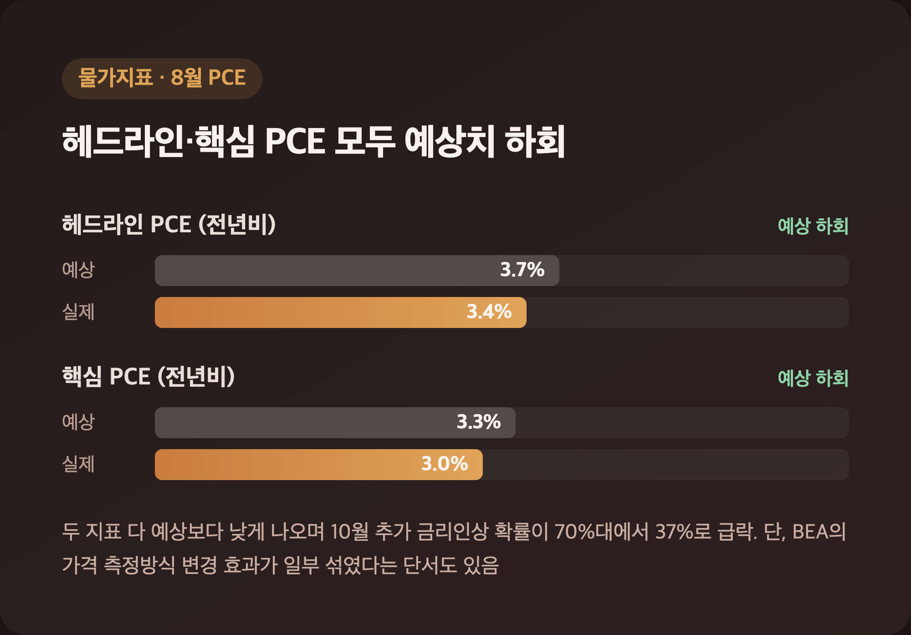
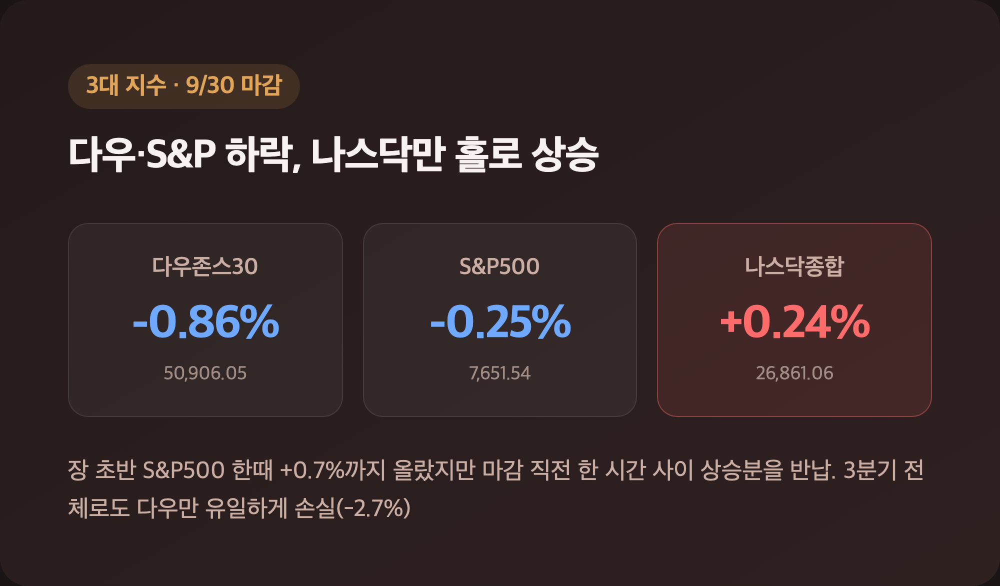
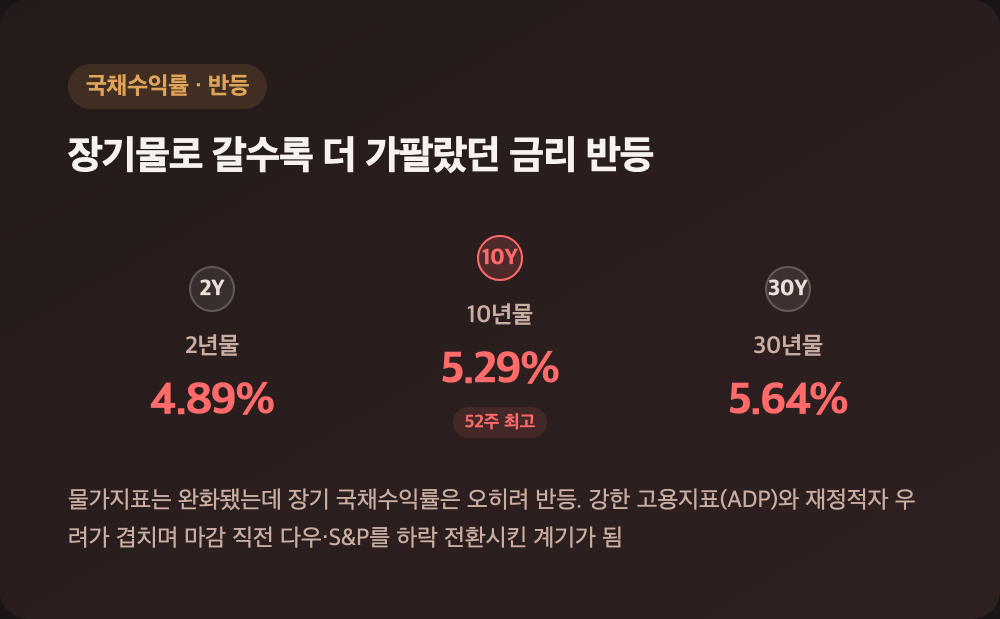
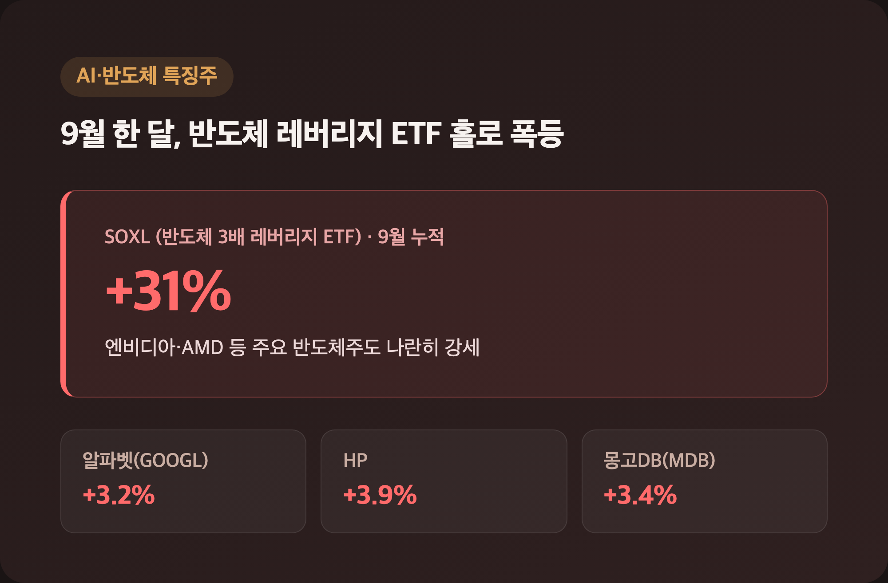

# [내일도 주린이] 다우 -0.86%·나스닥만 +0.24%...PCE 완화에도 금리 반등한 3분기 마지막날 미장 정리 (9/30)

3분기 마지막 거래일, 아침엔 물가지표가 좋게 나와서 다들 "오, 오늘은 좀 편하게 가나" 했는데요, 장 마감 한 시간 전부터 분위기가 확 뒤집혔더라고요. 왜 그랬는지, 오늘 뉴욕증시 미장 정리로 순서대로 풀어볼게요.

---

## 🔥 PCE 물가지표 완화 – 장 초반 랠리를 이끈 진짜 이유

> **8월 헤드라인 PCE +3.4%(예상 +3.7%) / 핵심 PCE +3.0%(예상 +3.3%)**

| 지표 | 전월 대비 | 전년 대비 | 예상(전년) |
|---|---|---|---|
| 헤드라인 PCE | +0.3% | +3.4% | +3.7% |
| 핵심 PCE(식품·에너지 제외) | +0.2% | +3.0% | +3.3% |

예상치를 밑돈 물가지표가 나오자마자 CME 페드워치 기준 10월 추가 금리 인상 확률이 70%대에서 37%로 뚝 떨어졌어요. "이제 좀 편해지나" 싶을 만한 소식이었는데, 여기엔 좀 복잡한 사정도 있었습니다. 미 경제분석국(BEA)이 법률서비스·소프트웨어·자산관리 수수료 등의 가격 측정 방식을 손보면서 7월 핵심 PCE 수준 자체를 0.36%포인트 낮춰 잡았거든요. 방법론이 바뀐 결과라는 걸 알고 나니 순수하게 물가가 꺾인 신호로만 보기엔 조금 애매하다는 생각도 들었는데, 그래도 두 지표 다 연준 목표치(2%)보다는 여전히 한참 높은 수준이라 "완화"라는 표현이 과하지 않다는 점은 분명했어요.

---

## 📉 3대 지수 혼조 마감 – 나스닥만 홀로 웃었다

> **다우 50,906.05(-443.87p, -0.86%) / S&P500 7,651.54(-19.30p, -0.25%) / 나스닥 26,861.06(+63.52p, +0.24%)**

| 지수 | 종가 | 등락률 | 9월(월간) | 3분기(Q3) |
|---|---|---|---|---|
| 다우존스30 | 50,906.05 | -0.86% | -4.28~4.3% | -2.7% |
| S&P500 | 7,651.54 | -0.25% | -0.45~0.5% | +2% |
| 나스닥종합 | 26,861.06 | +0.24% | +1.86~1.9% | +2.5% |

혹시 어제(9/29) 마감치랑 헷갈리실까 봐 미리 말씀드리는데, 검색하다 보니 시차 때문에 한국 매체 일부가 전일 수치를 오늘 걸로 잘못 표기한 기사도 있었더라고요(9/29 마감은 다우 51,349.92·S&P500 7,670.84·나스닥 26,797.54였어요). 오늘 다루는 위 수치는 여러 소스(TheStreet, Yahoo Finance, Bloomberg 배포, Investing.com, 국내 매체)가 소수점까지 일치한 진짜 9/30 정규장 마감치입니다. 장 초반엔 S&P500이 한때 +0.7%까지 올랐었는데, 마감 직전 한 시간 사이에 그 상승분을 다 반납하고 결국 다우·S&P는 하락 전환했어요. 9월 한 달, 3분기 전체로 봐도 나스닥만 뚜렷하게 앞서가고 다우는 3대 지수 중 유일하게 분기 손실을 냈다는 게 눈에 띄었습니다.

---

## 📈 국채수익률 반등 – 마감 직전 분위기를 뒤집은 주범

> **10년물 5.29%(52주 최고권) / 30년물 5.64% / 2년물 4.89%**

| 구분 | 수치 | 비고 |
|---|---|---|
| 2년물 | 4.89% | 상승 |
| 10년물 | 5.29% | 52주 최고 수준 |
| 30년물 | 5.64% | 상승 |

물가지표는 완화됐는데 장기 국채수익률은 오히려 더 튀었다는 게 오늘 하루의 핵심 아이러니였어요. "인플레 걱정은 줄었는데 왜 금리가 오르지" 싶었는데, 강한 고용지표(바로 아래 ADP)랑 재정적자·정부 채무 부담 우려가 장기물 수급을 더 세게 눌렀다고 보더라고요. 결국 이 되돌림이 마감 직전 다우·S&P500을 하락 전환시킨 직접적인 계기가 됐습니다.

---

## 💼 ADP 민간고용 서프라이즈 – 둔화 흐름을 뒤집었다

> **9월 민간고용 +90,000명(컨센서스 +68,000명) / 8월은 +36,000명으로 하향 수정**

| 업종 | 증가 인원 |
|---|---|
| 교육·보건 | +55,000명 |
| 레저·접객업 | +22,000명 |
| 제조업 | +17,000명 |
| 건설업 | +15,000명 |
| 기타서비스 | +6,000명 |
| 정보업 | +3,000명 |

임금 쪽도 기본급 전년 대비 +3.2%, 총급여 +4.7%로 꽤 단단하게 나왔어요. 직전 3개월 고용 둔화 흐름을 이 지표가 한 번에 뒤집은 셈인데, 이게 위에서 다룬 국채수익률 반등의 배경이기도 했습니다. 다만 ADP는 노동부 비농업고용지표(이번 주 금요일 발표, 예상 +84,000명)에 선행하는 참고 지표라 정부 통계랑 다소 다를 수 있다는 단서도 같이 따라붙었으니, 진짜 확인은 금요일에 한 번 더 해봐야 할 것 같아요.

---

## 🤖 AI·반도체 특징주 – 알파벳 급등, 9월 내내 이어진 반도체 랠리

> **알파벳 +3.2~3.3% / HP +3.9% / 몽고DB +3.4% / 반도체 레버리지 ETF 'SOXL' 9월 +31%**

| 종목/이슈 | 등락률·내용 |
|---|---|
| 알파벳(GOOGL) | +3.2~3.3%, 제미나이 월간활성사용자 10억 돌파·구글클라우드 수주 호재 |
| HP | +3.9%, AI붐 네트워킹 사업 호조 |
| 몽고DB(MDB) | +3.4%, 자사주 매입 10억 달러 확대 |
| 칼-메인 푸드 | -0.7%, 계란값 급락 여파 |

애플·테슬라·마이크로소프트 등 대형 기술주도 대체로 강세였는데, 9월 한 달만 놓고 보면 반도체 레버리지 ETF 'SOXL'이 31% 넘게 폭등했고 엔비디아·AMD 같은 주요 반도체주도 나란히 강세였다고 해요. 이런 숫자 볼 때마다 25주 들고 있는 삼성전자, 물량 있는 SK하이닉스 생각이 자연스럽게 나는데요, 미국 반도체 쪽 분위기가 이 정도로 좋았다면 국장 반도체주도 완전히 소외되진 않았겠다 싶었습니다. 계란값 떨어져서 주가가 빠졌다는 칼-메인 푸드 얘기는 좀 웃겼는데, "이런 것도 다 주가에 반영되는구나" 싶더라고요.

---

## 🛢️ 이란전쟁·유가 – 해소되지 않은 배경 리스크

> **WTI 90달러선 / 브렌트유 95달러 근접**

2월 말 시작된 이란전쟁이 4월에 조건부 휴전을 맺었다가도 여름 이후 호르무즈 해협 인근에서 충돌이 재발하면서, 국제유가가 다시 WTI 90달러·브렌트유 95달러 근접까지 올라온 상태예요. 9/30 당일 등락률을 정확히 확인해주는 소스는 못 찾았는데(그래서 레벨만 전달드려요), 이 지정학적 리스크가 안 풀린 채로 남아 있다는 것 자체가 물가·금리 불확실성의 배경으로 계속 거론되고 있었습니다.

---

## 마무리하며

3분기 마지막 거래일, 다우 -0.86%·S&P500 -0.25%로 마감하고 나스닥만 +0.24%로 3대 지수 중 홀로 웃었어요. 9월 한 달, 3분기 전체로 봐도 나스닥이 뚜렷하게 앞서고 다우는 유일하게 분기 손실을 낸 흐름이 그대로 이어진 셈입니다.

솔직히 아침에 물가지표 좋게 나왔을 때만 해도 "오늘은 다 같이 웃는 날이겠다" 싶었는데, 국채수익률이 마감 직전에 다시 튀어 오르면서 절반은 무너졌어요. 저는 일단 이번 주 금요일 비농업고용지표부터 확인하고, 반도체 쪽 분위기가 국장으로 얼마나 이어지는지 지켜보려고 합니다.

3분기 마지막 날까지 이렇게 엇갈릴 줄은 몰랐네요. 내일부터는 4분기, 마음가짐만이라도 손절 없이 가보겠습니다 🌱
