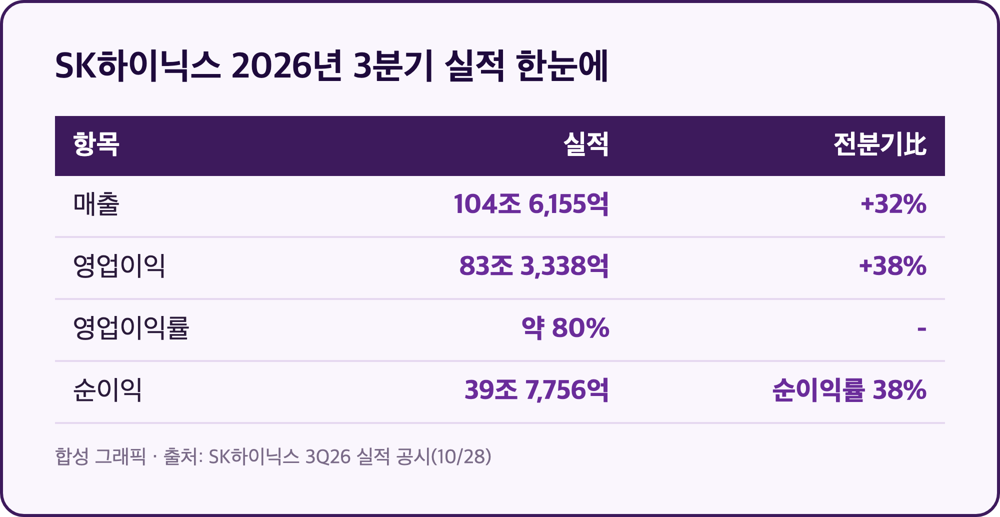
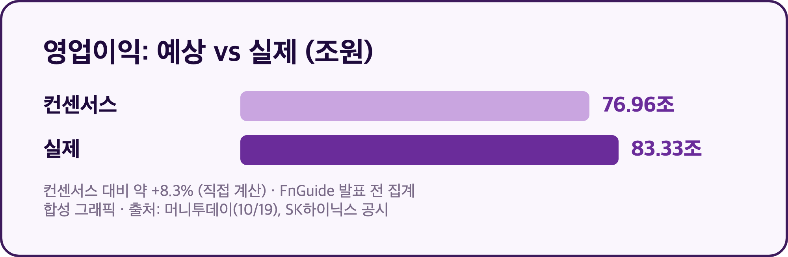
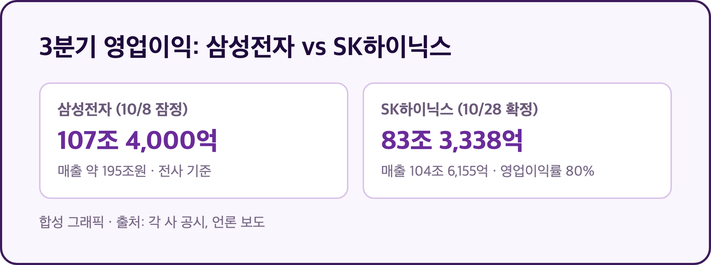
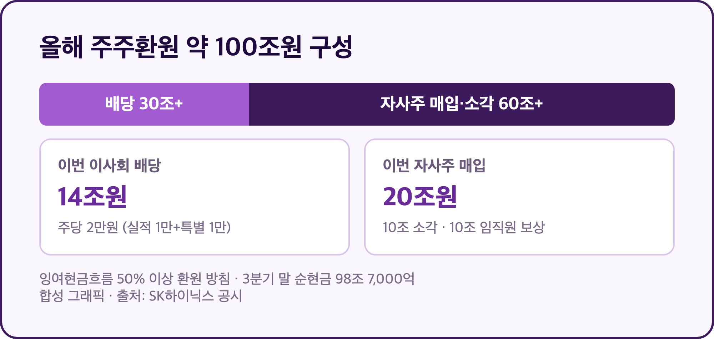
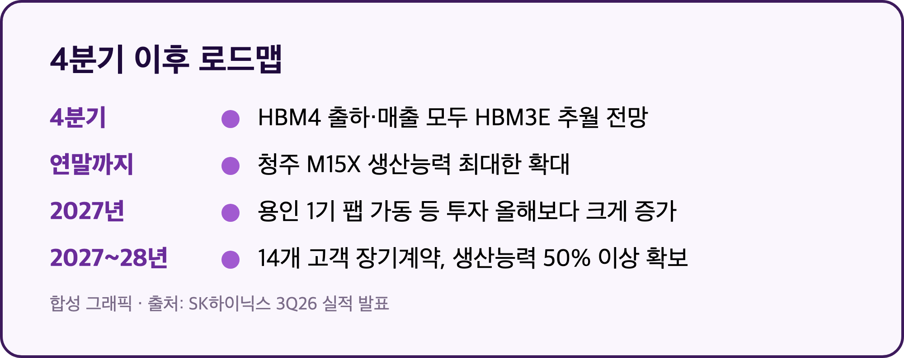

# [내일도 주린이] SK하이닉스 3분기 실적 영업이익 83조 3,338억…매출 첫 100조 돌파, 주주환원 100조 (10/28)

83조 3,338억원. SK하이닉스가 석 달 동안 번 영업이익입니다. 매출도 분기 기준으로 처음 100조원을 넘겼고요. 삼성전자 25주 들고 있는 입장에서 이 숫자가 뭘 의미하는지 같이 정리해볼게요.

참고로 SK하이닉스는 회계연도가 캘린더 연도와 같아서, 이번 건 2026년 3분기(7~9월) 실적이 맞습니다. 발표 일정이 매체마다 10/27, 10/29로 엇갈렸는데, 실제 공시는 오늘 10/28(수)에 나왔어요.

---

## 💰 매출 104조 6,155억, 영업이익 83조 3,338억 – 영업이익률이 80%예요

> **매출 104조 6,155억원 (전분기比 +32%) / 영업이익 83조 3,338억원 (전분기比 +38%) / 순이익 39조 7,756억원**

| 항목 | 3분기 실적 | 비교 |
|---|---|---|
| 매출 | 104조 6,155억원 | 2분기 79조 3,187억원, 전분기比 +32% |
| 영업이익 | 83조 3,338억원 | 2분기 60조 5,426억원, 전분기比 +38% |
| 영업이익률 | 약 80% | 컨센서스 기준 약 78.4% |
| 순이익 | 39조 7,756억원 | 순이익률 38% |
| 3분기 누적 | 매출 236조 5,105억원 / 영업이익 181조 4,867억원 | - |

매출 100원어치를 팔면 80원이 영업이익으로 남았다는 얘기예요. 제조업에서 이런 숫자를 본 적이 있나 싶습니다. 전년 동기 대비 증감률은 제가 확인한 기사들에 없어서 적지 않았고, 직전 분기와의 비교만 담았어요.

---

## 📊 시장 예상보다 얼마나 좋았나 – 영업이익 컨센서스 약 8% 상회

> **영업이익 83조 3,338억원 vs FnGuide 컨센서스 76조 9,640억원 (약 +8.3%) / 매출 컨센서스 약 103조 3,000억원 (약 +1.3%)**

발표 전 FnGuide 영업이익 컨센서스가 76조 9,640억원이었으니 6조 원 넘게 웃돈 셈이에요. (+8.3%는 제가 두 숫자로 직접 계산한 값입니다. 매출 컨센서스는 애널리스트 27명 집계 하나만 확인돼서 참고용으로만 봐주세요.)

실적 동력은 회사 설명 기준으로 두 가지예요. D램에서는 HBM4 출하가 본격화됐고 서버용 DDR5 판매가 크게 늘었어요. 낸드는 321단 TLC 기반 기업용 SSD 판매가 늘었습니다. 발표 당일 주가 반응과 증권사 코멘트는 제가 글을 쓰는 시점에 확인하지 못했어요.

---

## 🇰🇷 삼성전자 25주 입장에서 – 이번엔 삼성이 숫자는 더 커요

> **삼성전자 3분기 잠정 영업이익 107조 4,000억원 (10/8 공시) / SK하이닉스 83조 3,338억원 (10/28 확정)**

삼성전자는 10/8에 3분기 잠정 영업이익 107조 4,000억원, 매출 약 195조원을 먼저 내놨어요. 영업이익 절대금액은 삼성이 더 큽니다. 다만 삼성은 스마트폰·가전까지 합친 전사 숫자고, 하이닉스는 사실상 메모리 한 우물이라 영업이익률은 하이닉스가 80%로 훨씬 높아요.

저한테 중요한 건 이 숫자가 "메모리 업황이 아직 꺾이지 않았다"는 두 번째 증거라는 점이에요. 삼성전자가 잠정으로 보여준 호황을 하이닉스 확정치가 한 번 더 확인해줬거든요. 오늘 삼성전자 주가가 어떻게 반응했는지는 아직 확인 전이라 이 글에서는 말을 아낄게요.

---

## 🎁 주주환원 올해 약 100조원 – 3분기 주당 배당금 2만원

> **올해 주주환원 약 100조원 (현금배당 30조원+ / 자사주 매입·소각 60조원+) / 3분기 배당 14조원 / 자사주 매입 20조원**

이번 이사회에서는 3분기 현금배당 14조원과 자사주 매입 20조원이 결의됐어요. 자사주 20조원 중 10조원은 소각하고, 나머지 10조원은 임직원 보상에 쓰는데 이쪽은 주주환원 규모에서 빠집니다. 8월에 발표한 40조원 자사주 매입은 이미 끝났고 조만간 소각할 예정이고요.

3분기 주당 배당금은 2만원인데, 실적 연동분 1만원에 키옥시아 투자 수익을 반영한 특별 배당 1만원이 합쳐진 금액이에요. 앞으로 잉여현금흐름의 50% 이상을 주주에게 돌려주겠다는 방침도 밝혔습니다. 3분기 말 순현금이 98조 7,000억원이라, 곳간이 비어서 못 주는 상황은 아니에요.

---

## 🔮 4분기 이후 – HBM4가 주력으로, 2027~2028년 물량은 절반 이상 계약 완료

> **4분기 HBM4 출하·매출 모두 HBM3E 추월 전망 / 장기공급계약 14개 고객, 2027~2028년 생산능력 50% 이상 확보**

회사는 4분기에 HBM4가 출하량과 매출 모두에서 HBM3E를 앞지를 것으로 내다봤어요. 메모리 공급 부족이 2030년까지 이어질 거라는 전망과 함께, 14개 주요 고객과 맺은 장기공급계약으로 2027~2028년 전체 생산능력의 50% 이상이 이미 잡혀 있다고 했습니다. 가격은 합의 범위 안에서 시장 상황을 반영하는 구조라고 해요.

돈 쓸 곳도 같이 늘어납니다. 2027년 투자는 용인 1기 팹 가동 등으로 올해보다 크게 늘 전망이고, 청주 M15X는 연말까지 생산능력을 최대한 끌어올린대요. 한편 블룸버그는 솔리다임이 450억달러(약 60조원)를 들여 미국에 낸드 공장을 짓는 방안을 협의 중이라고 보도했는데, 아직 확정된 내용은 아닙니다.

---

## 마무리하며

매출 104조 6,155억원, 영업이익 83조 3,338억원, 영업이익률 80%. 컨센서스를 약 8% 웃돌았고, 주주환원은 올해만 약 100조원 규모입니다.

내일부터 볼 건 세 가지예요. 삼성전자·하이닉스 주가가 이 숫자에 어떻게 반응하는지, 삼성전자 확정 실적, 그리고 4분기 HBM4 전환 속도. 삼성전자 25주는 일단 그대로 갑니다.
