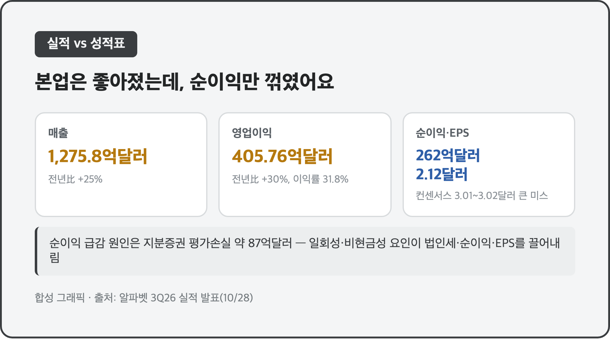
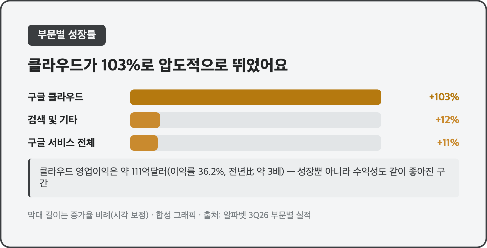
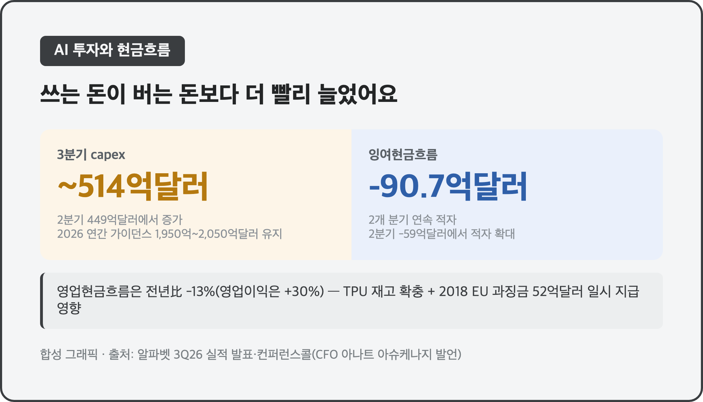
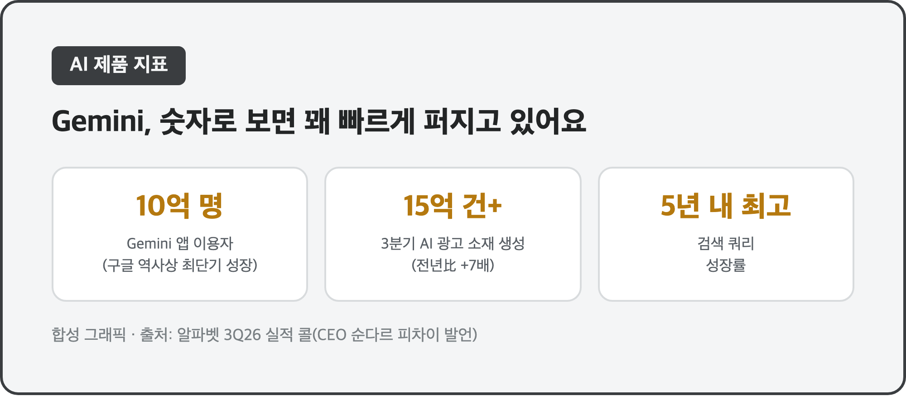
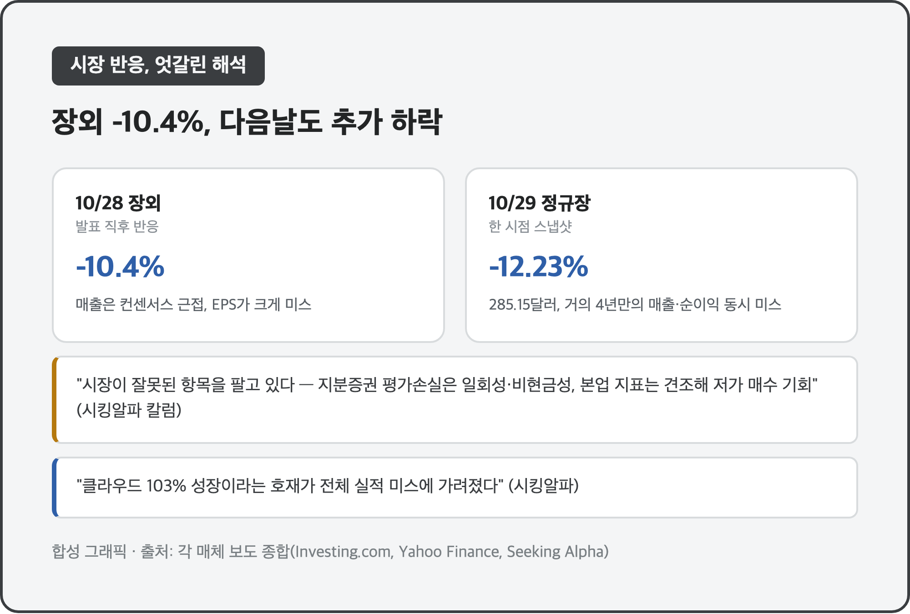

# [내일도 주린이] 알파벳 3분기 매출 25% 성장, 클라우드 103% 폭증…그런데 주가는 왜 10% 넘게 빠졌을까 (10/30)

클라우드 매출이 103% 뛰고 분기 매출이 25% 늘었는데 주가는 왜 장외에서 10% 넘게 빠졌을까요? 어제 국장 정리 글 끝에 "알파벳이 변수"라고 짧게만 적어뒀는데, 오늘은 그 알파벳(구글 모회사) 3분기 실적을 제대로 뜯어보려고 해요. 저도 오라클(ORCL) 42.51주를 들고 있어서, 구글 클라우드가 103% 성장했다는 숫자가 그냥 남 얘기로는 안 읽히더라고요.

알파벳은 현지시간 10/28(수) 장 마감 후 2026년 3분기(7~9월) 실적을 발표했어요.

---

## 📈 매출은 사상 최대인데 순이익은 반토막 – 지분증권 평가손실의 함정

> **매출 1,275억 8,000만달러 (전년比 +25%) / 영업이익 405억 7,600만달러 (+30%, 영업이익률 31.8%) / 순이익 262억달러, EPS 2.12달러 (컨센서스 3.01~3.02달러 대비 큰 미스)**

| 항목 | 3분기 실적 | 전년 동기 | 비교 |
|---|---|---|---|
| 매출 | 1,275억 8,000만달러 | 1,023억 4,600만달러 | +25%, 컨센서스(약 1,279억 7,000만달러)는 소폭 못 미침 |
| 영업이익 | 405억 7,600만달러 | 312억 2,800만달러 | +30%, 영업이익률 31.8% |
| 순이익 | 262억달러 | 349억 8,000만달러 | 전년 대비 감소 |
| EPS | 2.12달러 | - | 컨센서스 3.01~3.02달러 대비 큰 미스 |

본업 지표만 보면 나쁠 게 하나도 없어요. 매출은 13개 분기 연속 두 자릿수 성장을 이어갔고 영업이익률도 전년보다 좋아졌거든요. 그런데 순이익과 EPS가 와르르 무너진 이유가 따로 있었어요. 회사가 들고 있던 지분증권(다른 회사 주식 같은 투자자산)에서 약 87억달러 규모의 평가손실이 나면서 법인세·순이익·EPS를 한꺼번에 끌어내린 거예요. 쉽게 말하면 "장사는 더 잘했는데, 투자해둔 주식 장부가가 깎여서 성적표 맨 아래 숫자만 나빠 보이는" 구조였던 거죠. 저는 이 숫자를 처음 봤을 때 "어 영업이익은 괜찮은데 왜 순이익이 이렇게 빠졌지" 하고 한참 다시 읽었어요.

---

## ☁️ 구글 클라우드 103% 급증 – 오라클 들고 있는 입장에서 특히 눈에 밟혔어요

> **구글 클라우드 매출 307억 900만달러 (전년比 +103%, 6개 분기 연속 가속) / 클라우드 영업이익 약 111억달러 (영업이익률 36.2%, 전년比 3배 가까이)**

| 항목 | 3분기 | 전년 동기 | 비교 |
|---|---|---|---|
| 구글 클라우드 매출 | 307억 900만달러 | 151억 5,700만달러 | +103% |
| 클라우드 영업이익 | 약 111억달러 | - | 영업이익률 36.2%, 전년比 약 3배 |
| 구글 서비스 매출 | 963억달러 | - | +11% |
| 검색 및 기타 매출 | 633억 5,000만달러 | - | +12%, 검색 쿼리 성장률 5년 내 최고 |
| 유튜브 광고 매출 | 112억 700만달러 | - | - |

엔터프라이즈 AI 인프라·AI 솔루션 수요에 핵심 GCP 서비스, 그리고 TPU(구글 자체 AI 반도체) 시스템 판매까지 고르게 기여했다고 해요. 클라우드 영업이익률 36.2%는 "이제 클라우드가 적자를 면한 수준이 아니라 진짜 돈을 버는 사업부가 됐다"는 뜻이라 눈에 들어왔어요. 저는 ORCL(오라클) 42.51주를 평단 178.75달러에 들고 있는데, 지금 -29%대 손실 구간이거든요. 오라클도 클라우드 인프라(OCI)로 AI 붐에 베팅한 회사라, 구글 클라우드가 103% 성장했다는 건 같은 전쟁터에서 경쟁자가 더 세졌다는 뜻이기도 해요. 반대로 생각하면 클라우드 AI 인프라 시장 전체 파이가 커지고 있다는 신호로도 볼 수 있어서, 마음이 복잡하더라고요.

---

## 💸 AI에 쏟는 돈이 너무 커서 현금이 마이너스 – 잉여현금흐름 2개 분기 연속 적자

> **3분기 capex 약 513억~514억달러 (2분기 449억달러에서 증가) / 2026 연간 capex 가이던스 1,950억~2,050억달러 유지(동결) / 잉여현금흐름 -90억 7,000만달러(2개 분기 연속 적자, 2분기는 -59억달러)**

| 항목 | 3분기 | 비고 |
|---|---|---|
| capex | 약 513억~514억달러 | 애널리스트 예상(약 551억달러)엔 못 미침 |
| 2026 연간 capex 가이던스 | 1,950억~2,050억달러 | 1분기 발표 당시 1,800억~1,900억달러에서 2분기에 상향, 3분기엔 동결 |
| 영업현금흐름 | 423억달러 | 전년比 -13% (영업이익은 +30%인데 반대 방향) |
| 잉여현금흐름 | -90억 7,000만달러 | 2분기 -59억달러에서 적자 확대 |

capex의 약 65%가 서버·네트워킹 장비 쪽이고, TPU 재고를 쌓은 것과 2018년 EU 경쟁당국 과징금 52억달러를 이번에 실제로 낸 것도 현금흐름을 깎아먹었다고 해요. CFO 아나트 아슈케나지는 실적 콜에서 "2027년엔 capex가 지금보다 유의미하게 더 늘어날 것"이라고 했고, 일부 보도에서는 2027년 연간 capex가 3,000억달러를 넘을 수 있다는 전망까지 나왔어요. 영업이익은 30% 늘었는데 영업현금흐름은 13% 줄었다는 대목이 저는 제일 이상하게 느껴졌는데요, "번 돈보다 쌓아둔 재고·투자에 묶인 돈이 더 빨리 늘고 있다"는 뜻으로 읽혔어요.

---

## 🤖 Gemini 앱 10억 명, 검색 쿼리는 5년 내 최고 – AI가 진짜 쓰이고 있다는 증거들

> **Gemini 앱 이용자 10억 명 돌파(구글 역사상 최단기 성장 제품) / 3분기 Gemini 기반 광고 캠페인 소재 생성 15억 건 이상(전년比 +7배) / 검색 쿼리 성장률 5년 내 최고**

CEO 순다르 피차이는 AI 투자가 검색 쿼리 성장(상업적 쿼리 포함) 전반을 견인하고 있다고 밝혔어요. 새 모델 패밀리 Gemini 4(코드네임 "Argon", "Carbon")가 프론티어 모델 경쟁에서 앞서 있다고도 소개했고요. 숫자로 보면 AI 오버뷰·AI 모드 같은 검색 내 AI 기능이 확대되면서 검색 쿼리 자체가 5년 만에 가장 빠르게 늘었고, 광고주들이 Gemini로 캠페인 소재를 만드는 양도 1년 전보다 7배 넘게 늘었다고 해요. "AI 때문에 검색이 죽는다"는 걱정이 한동안 많았는데, 적어도 이번 숫자들은 반대 방향을 가리키고 있었어요.

---

## 📉 장외 -10.4%, 다음날도 추가 하락 – "숫자를 잘못 팔았다" vs "저가 매수 기회"

> **발표 당일(10/28) 장외 -10.4% / 10/29 정규장 한 시점 기준 전일比 -12.23%, 285.15달러 (거의 4년 만의 매출·순이익 동시 미스)**

| 시점 | 하락률 | 비고 |
|---|---|---|
| 10/28 장 마감 후 (장외) | -10.4% | 실적 발표 직후 반응 |
| 10/29 정규장 (한 시점 스냅샷) | -12.23%, 285.15달러 | 전일比, 시점이 달라 장외 수치와 단순 비교는 어려움 |

매출은 컨센서스에 거의 근접했는데 EPS가 크게 미스했다는 게 1차 이유였고, 거의 4년 만에 매출·순이익을 동시에 시장 예상 밑으로 내놓은 분기라는 점이 더 아프게 작용했다고 해요. 다만 시장 해석이 완전히 한쪽으로만 쏠린 건 아니었어요. 시킹알파의 한 칼럼은 "시장이 잘못된 항목을 팔고 있다"며, EPS를 깎은 지분증권 평가손실이 일회성·비현금성 요인인 만큼 매출 성장·영업이익·클라우드 이익률 같은 본업 지표는 오히려 견조해서 저가 매수 기회일 수 있다고 봤어요. 반대로 다른 칼럼은 "클라우드 103% 성장이라는 호재가 전체 실적 미스에 가려졌다"고 짚었고요. 저는 이번엔 어느 쪽이 맞을지 당장 판단하긴 어렵지만, 오라클을 들고 있는 입장에서 "AI 클라우드 전쟁이 끝난 게 아니라 이제 막 본격화됐다"는 쪽에는 동의가 되더라고요.

---

## 마무리하며

매출 1,275억 8,000만달러로 25% 늘고 클라우드는 103% 폭증했는데, 순이익은 지분증권 평가손실 탓에 262억달러로 줄면서 주가가 장외 10%대, 다음날도 추가로 빠졌어요. 본업은 좋아졌는데 성적표 맨 아래 숫자 하나 때문에 시장이 크게 흔들린 하루였습니다.

다음 분기 콜(4분기 실적)에서 2027년 capex 구체안이 얼마나 더 커질지, 그리고 ORCL이 이 흐름에서 어떻게 반응할지를 계속 지켜볼 것 같아요. 어제는 삼성전기까지 들썩이게 했던 소식인데, 오늘 들여다보니 생각보다 복잡한 그림이었네요 🧐
