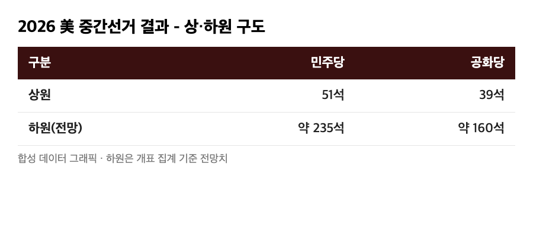
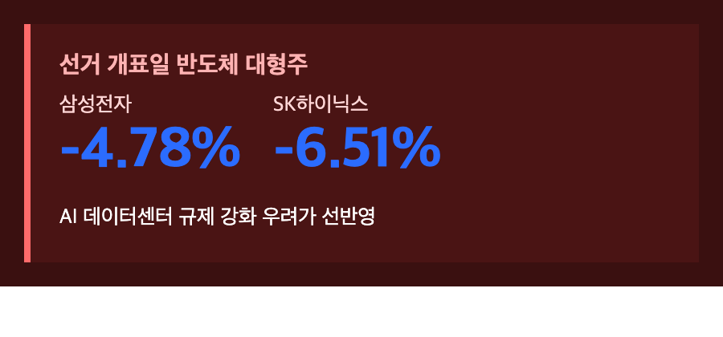
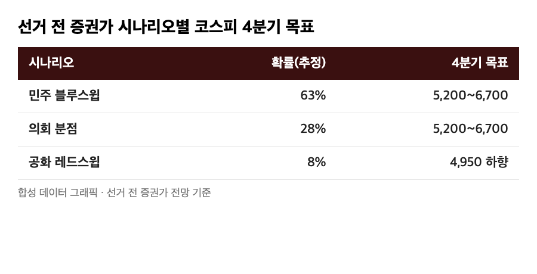
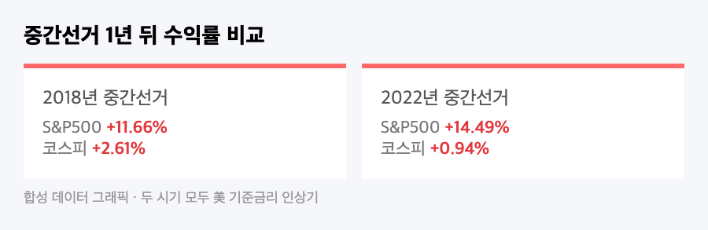

# [내일도 주린이] 美 중간선거 '블루 스윕' 확정…코스피는 왜 급등하다 급락했나 (11/4)

어젯밤부터 미국 중간선거 개표 속보 틀어놓고 있었는데요, 오늘 장 열리자마자 코스피가 2%대로 치솟는 거 보고 "오, 이번엔 호재로 가나" 했습니다. 근데 점심 무렵 되니까 그 상승분이 전부 날아가고 오히려 마이너스로 꺾여 있더라고요. 저도 들고 있는 삼성전자가 딱 이 흐름 한가운데 있어서, 오늘은 선거 결과가 국장에 실제로 어떻게 꽂혔는지 숫자로 정리해봤어요.

---

## 🇺🇸 선거부터 정리하면 — 민주당, 상·하원 다 가져갔다

> **상원 민주 51석 : 공화 39석 / 하원 민주 약 235석(최대 242석 전망) : 공화 160석**

11월 3일(현지시간) 인디애나·켄터키주부터 시작된 투표가 한국시간 4일 오전부터 순차적으로 마감됐는데, 결과는 생각보다 깔끔했어요. 텍사스·캔자스에서 각각 첫 민주당 상원의원이 나왔고, 오하이오·아이오와·노스캐롤라이나·사우스캐롤라이나까지 뒤집히면서 상원도 민주당이 과반을 확보했습니다. 하원은 하버드대 선거 모델 기준 민주당 승리 확률이 96%까지 올라갔다고 하니, 사실상 '블루 스윕'이 확정된 셈이에요. 선거 전엔 대신증권 등에서 "승부처는 상원, 여론조사가 1.4%p만 빗나가도 결과가 뒤집힐 수 있다"는 신중한 전망도 나왔었는데, 실제로는 그보다 훨씬 깨끗하게 민주당 쪽으로 쏠렸습니다.

## 📉 코스피, 오늘 하루 7%p 가까이 왕복했다

> **코스피 장중 5,786.13(+2.43%) → 오후 1시 5,432.24(-3.83%)**

개장하자마자 코스피가 전일 대비 137.34포인트(+2.43%) 오른 5,786.13까지 치고 올라가면서 한때 5,800선을 넘봤어요. "선거 불확실성 해소니까 오르는구나" 싶었는데, 민주당 우세가 확실해지는 시점부터 분위기가 완전히 바뀌더라고요. 오후 1시 기준으로는 전일 대비 216.55포인트(-3.83%) 내린 5,432.24까지 밀렸습니다. 하루 사이에 고점과 저점을 합치면 7%p 가까이 움직인 거예요. 전날(11/3)에도 코스피 변동성지수(VKOSPI)가 54.08까지 치솟았었는데, 이게 10월 15일 코스피가 하루 만에 7% 급락했던 그날 이후 최고치라고 해요. 선거 하나 때문에 이틀째 롤러코스터를 탄 셈이죠.

## 🔻 급락 원인 — AI 데이터센터 규제 우려, 그리고 제 삼성전자

> **삼성전자 -4.78% / SK하이닉스 -6.51%**

오전 상승분을 다 반납하게 만든 주범은 반도체였어요. 유안타증권 연구원은 "민주당의 의회 장악과 주요 주지사 선거 결과에 따른 (AI 데이터센터) 규제 강화 가능성이 반영되고 있다"고 짚었는데, 실제로 민주당 지지층의 80%가 AI 규제 강화에 찬성하고 69%가 데이터센터 건설 제한에 찬성한다는 여론조사가 있다 보니 시장이 바로 겁을 먹은 거죠. 저도 삼성전자 25주 들고 있는 입장에서 오늘 -4.78%는 꽤 아프긴 한데, "이게 또 하루짜리 공포인지 진짜 구조적인 변화인지" 구분해봐야 할 것 같아요. 수급을 보면 개인(+1조2,752억원)과 기관(+3,249억원)은 오히려 사면서 버텼는데, 외국인이 1조8,591억원을 순매도하면서 지수를 끌어내렸거든요. 같은 날 다른 집계에서는 외국인·기관 합산 '2조 투매'라는 표현도 나왔고, 그 와중에 AI·배터리는 추락했지만 조선주는 비교적 버텼다는 얘기도 있었어요.

## 🔮 선거 전 증권가가 그려놨던 세 가지 시나리오

사실 선거 전부터 증권가는 결과별로 코스피 그림을 다르게 그려놨었어요.

| 시나리오 | 선거 전 확률(추정) | 4분기 코스피 목표 | 핵심 근거 |
|---|---|---|---|
| 민주 '블루 스윕' | 63% | 5,200~6,700 | 국채금리·달러 안정, 연준 견제로 불확실성 감소 |
| 의회 분점 | 28% | 5,200~6,700 (기존 유지) | - |
| 공화 '레드 스윕' | 8% | 4,950까지 하향 | 재정지출·관세 확대로 금리 15~30bp 상승 |

실제 결과가 가장 확률 높게 점쳐졌던 '블루 스윕'으로 나왔으니, 표대로라면 코스피엔 나쁘지 않은 그림이어야 하는데요. 그런데 막상 오늘 장에서는 반도체 규제 우려가 먼저 튀어나오면서 정반대로 급락했어요. 선거 전 전망과 선거 당일 실제 반응이 이렇게 엇갈릴 수 있다는 걸 눈으로 본 셈이죠. 한지영 키움증권 연구원도 "증시 현금흐름 악화의 근본 원인은 정책 불확실성이 아니라 AI 투자에 대한 의구심"이라고 했는데, 오늘 장은 그 말이 딱 맞아떨어진 날 같아요.

## 📊 과거에도 중간선거 뒤 코스피가 이렇게 흔들렸을까

역사적으로 보면 미국 중간선거는 S&P500에는 거의 항상 호재였어요. 1958년부터 2022년까지 17번의 중간선거 모두 1년 뒤 S&P500이 올랐고 평균 상승률이 13.98%였다고 하니, 17전 17승인 거죠. 코스피도 1998년 이후 중간선거 해 11월엔 7번 모두 올랐고 평균 +5.72%였대요. 다만 최근 두 번은 얘기가 좀 달라요. 2018년 중간선거 1년 뒤 S&P500은 +11.66%였는데 코스피는 +2.61%에 그쳤고, 2022년엔 S&P500 +14.49% 대비 코스피는 +0.94%로 거의 제자리걸음이었어요. 공통점은 두 시기 다 미국이 기준금리를 올리던 시기였다는 거예요. 그러니까 "선거 자체"보다 "그 뒤 금리가 어디로 가는지"가 코스피한텐 더 중요한 변수였다는 얘기고, 오늘 급락도 그 연장선에서 봐야 할 것 같아요.

## 🏭 그래도 관세·보조금은 생각보다 안 바뀔 수도 있다

관세·통상은 원래 의회 권한이 아니라 대통령 고유 권한 영역이라, 의회 구도가 바뀌어도 트럼프 대통령의 관세 기조 자체는 크게 안 흔들릴 거라는 분석이 많아요. 즉 블루 스윕이 한국 기업에 대한 통상 압박을 자동으로 풀어주진 않는다는 뜻이죠. 반도체 보조금도 비슷해요 — 미 상무부가 이미 삼성전자에 최대 47억4,500만달러, SK하이닉스에 4억5,800만달러 직접 보조금을 확정해둔 상태라, 양당 모두 미국 내 공장 유치를 원하는 만큼 이 돈이 갑자기 사라질 가능성은 낮다고 봐요. 반대로 친환경에너지·이차전지(한화솔루션, LG에너지솔루션, 삼성SDI 등)는 투자세액공제(ITC) 부활 기대로 수혜주로 꼽히고 있고, 조선업은 미·공화당 색이 강했던 MASGA 프로젝트 추진력 약화 우려가 같이 걸려있는 상태예요.

---

## 마무리하며

오늘 하루만 놓고 보면 코스피는 +2.43%에서 -3.83%까지, 왕복 7%p 가까이 움직였고 주범은 반도체 규제 우려였어요. 역사적으로는 중간선거 뒤 증시가 오르는 게 압도적으로 많았지만, 오늘 보니 그 '역사'가 당장 내일 숫자를 보장해주진 않는다는 걸 다시 느꼈습니다. 금리랑 AI 투자 분위기가 어떻게 흘러가는지가 결국 더 중요한 변수일 것 같고요. 삼성전자 들고 있는 저로서는 이번 주 반도체 관련 추가 뉴스부터 챙겨봐야겠습니다 🫠
