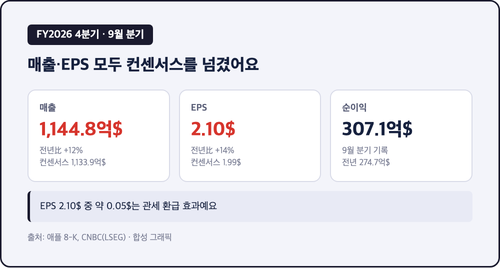
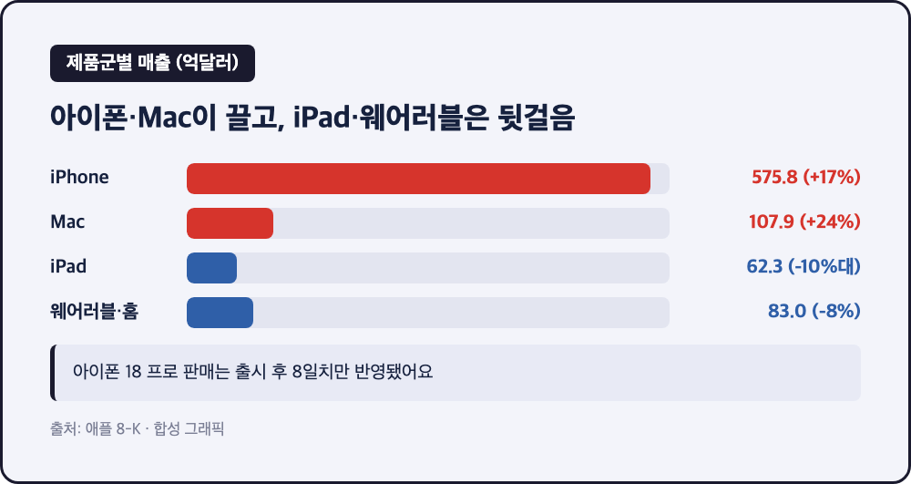
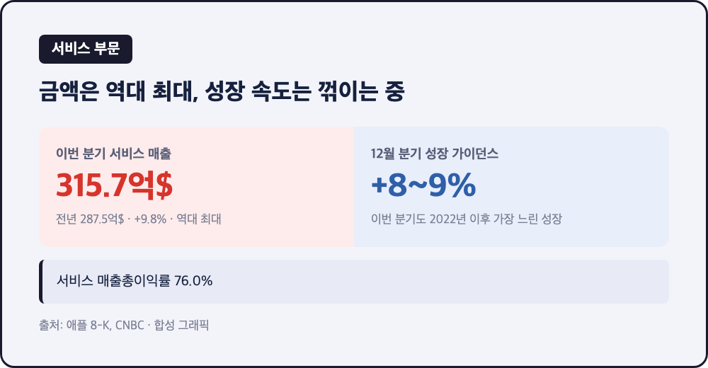
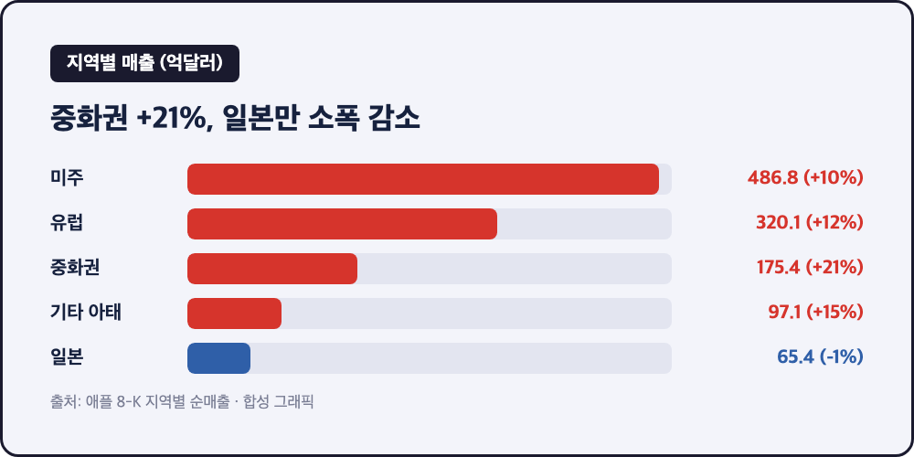
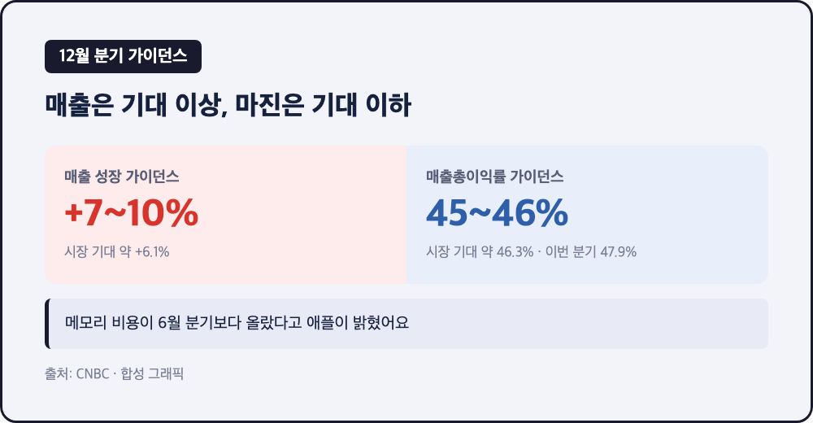

# [내일도 주린이] 애플 4분기 매출 1,145억달러 역대급…마진 가이던스에 시간외 하락 (11/3)

1,144억 8,000만달러. 9월 분기 기준으로 애플이 지금까지 낸 매출 중 가장 큰 숫자예요. 그런데 발표 직후 시간외 주가는 오히려 밀렸습니다.

애플은 현지시간 11/2(월) 장 마감 후 2026 회계연도 4분기(7~9월) 실적을 내놨어요. 회계연도 기준으로는 '3분기'가 아니라 4분기라서 헷갈리기 쉬운데요, 애플은 9월에 회계연도가 끝나기 때문이에요. 존 터너스 신임 CEO의 첫 실적 발표이기도 했고요.

---

## 📱 매출 1,145억달러·EPS 2.10달러 – 컨센서스를 넘긴 기록적인 9월 분기

> **매출 1,144억 8,000만달러 (전년比 +12%, 컨센서스 1,133억 9,000만달러) / EPS 2.10달러 (+14%, 컨센서스 1.99달러) / 순이익 307억 1,000만달러**

| 항목 | 4분기 실적 | 전년 동기 | 비교 |
|---|---|---|---|
| 매출 | 1,144억 8,000만달러 | 1,024억 7,000만달러 | +12%, 컨센서스 상회 |
| 순이익 | 307억 1,000만달러 | 274억 7,000만달러 | 9월 분기 기록 |
| EPS | 2.10달러 | 1.85달러 | +14%, 관세 환급 약 0.05달러 포함 |
| 매출총이익률 | 47.9% | - | 관세 환급 약 1%p 포함, 직전 분기 50.1%에서 하락 |

애플이 7월에 제시했던 4분기 가이던스는 매출 +9~11%였는데, 실제로는 +12%로 그 위를 뚫고 나왔어요. EPS 2.10달러 중 5센트 정도는 관세 환급 덕이라는 점은 짚고 가야 하고요. 연간으로 보면 FY2026 매출이 4,788억달러로 역대 최대, 전년(4,162억달러)보다 15% 늘었습니다. 터너스 CEO는 "best fiscal year ever"라고 표현했어요.

---

## 🍎 아이폰 17% 성장, Mac 24% 점프 – 반대로 iPad와 웨어러블은 뒷걸음

> **iPhone 575억 8,300만달러 (+17%, 컨센서스 565억 4,000만달러) / Mac 107억 9,200만달러 (+약 24%) / iPad 62억 2,900만달러 (-10%대) / 웨어러블·홈 83억달러 (약 -8%)**

| 제품군 | 4분기 매출 | 전년 동기 | 컨센서스 대비 |
|---|---|---|---|
| iPhone | 575억 8,300만달러 | 490억 2,500만달러 | 상회 (565억 4,000만달러) |
| Mac | 107억 9,200만달러 | 87억 2,600만달러 | 상회 (96억 1,000만달러) |
| iPad | 62억 2,900만달러 | 69억 5,200만달러 | 하회 (67억달러) |
| 웨어러블·홈·액세서리 | 83억달러 | 90억 1,300만달러 | 하회 (약 90억 6,000만달러) |

숫자만 던지면 아이폰이 판 전체를 끌고 갔어요. 게다가 이번 분기에는 아이폰 18 프로가 풀린 지 8일 치 판매만 들어가 있다고 해요. 그러니까 신제품 효과가 아직 본격 반영되기도 전의 숫자라는 얘기죠. Mac도 컨센서스를 1억달러 넘게 웃돌며 24% 가까이 늘었습니다. 반면 iPad는 컨센서스(67억달러)를 밑돌며 10%대 감소했고, 웨어러블·홈 부문도 8% 가까이 줄었어요. 한 회사 안에서 잘 나가는 줄과 못 나가는 줄이 이렇게 갈리는 게 이번 분기의 특징이었습니다.

---

## 🧾 서비스 315억 7,300만달러 역대 최대인데 성장률은 2022년 이후 가장 느려요

> **서비스 매출 315억 7,300만달러 (+9.8%, 역대 최대) / 서비스 매출총이익률 76.0% / 12월 분기 서비스 성장 가이던스 +8~9%**

서비스는 금액으로는 분기 최대 기록을 또 새로 썼어요. 다만 CNBC는 이 성장률이 10%에 못 미쳐서 2022년 이후 가장 느리다고 짚었고, 다음 분기 가이던스도 +8~9%로 더 낮게 잡혀 있습니다. 서비스는 마진이 76%대라 애플의 이익을 떠받치는 축인데, 이 축의 증가 속도가 조금씩 꺾이고 있다는 점이 이번 시장 반응에서 눈여겨볼 대목이에요.

---

## 🌏 중화권 +21%, 175억 3,900만달러 – 연간으로는 824억달러까지

> **중화권 175억 3,900만달러 (전년 144억 9,300만달러, +21%) / 미주 486억 8,000만달러 / 유럽 320억 800만달러 / 일본 65억 4,000만달러 (소폭 감소)**

지역별로는 중화권이 +21%로 가장 가파르게 뛰었어요. FY2026 연간으로 보면 중화권 매출이 824억달러로 전년(644억달러)보다 크게 늘었습니다. 미주와 유럽도 각각 10%대 성장이었고, 일본만 65억 4,000만달러로 전년(66억 3,600만달러)보다 살짝 줄었어요. 지난해 이맘때는 중국 부진이 약점으로 꼽혔다는 걸 떠올리면 이번 지역 구성은 확실히 달라졌습니다.

---

## ⚠️ 12월 분기 마진 45~46% 가이던스 – 메모리 값이 애플 마진까지 건드리고 있어요

> **12월 분기 매출 성장 +7~10% (컨센서스 약 6.1%) / 매출총이익률 가이던스 45~46% (컨센서스 46.3%, 이번 분기 47.9%) / 시간외 하락(낙폭은 미확인)**

| 항목 | 12월 분기 가이던스 | 시장 기대 |
|---|---|---|
| 매출 성장률 | +7~10% | 약 +6.1% |
| 서비스 성장률 | +8~9% | - |
| 매출총이익률 | 45~46% | 약 46.3% |

매출 가이던스는 시장 기대보다 오히려 좋았는데, 마진이 기대에 못 미쳤어요. 이유로 언급된 게 메모리 비용입니다. 애플은 이번 분기에도 6월 분기보다 메모리 비용이 높았고, 재고와 다른 부품 가격 하락으로 일부만 상쇄했다고 밝혔어요. 터너스 CEO가 6월에 전 제품 가격을 "reluctantly(마지못해)" 올렸다고 말한 것도 같은 맥락으로 읽혔고요. 시간외에서 주가가 밀렸다는 보도는 있었지만, 정확한 낙폭은 제가 확인한 자료에서는 나오지 않았습니다.

저는 여기서 삼성전자 25주를 들고 있는 입장이라 솔직히 마음이 묘했어요. 애플이 메모리 값 때문에 마진이 눌린다고 하는 건, 반대편에서는 메모리를 파는 쪽(삼성전자·SK하이닉스)이 가격을 잘 받고 있다는 뜻으로도 읽히거든요. 앞서 정리한 삼성전자 3분기 영업이익 107조원도 이 흐름과 이어지는 숫자로 보입니다. 다만 이건 제 해석이고, 애플이 삼성·하이닉스 어느 쪽에서 얼마나 사는지는 이번 발표에 나오지 않았어요.

---

## 마무리하며

매출 1,144억 8,000만달러, EPS 2.10달러로 컨센서스를 넘겼고 연간 매출도 4,788억달러로 역대 최대였는데, 마진 가이던스 45~46%가 기대에 못 미치면서 시간외에서는 밀렸습니다. 숫자는 좋았는데 다음 분기 마진이 발목을 잡은 날이었어요.

저는 애플을 직접 들고 있지는 않지만, 메모리 값이 완제품 회사의 마진에서 어떻게 드러나는지 지켜보는 건 삼성전자 주주로서 계속 챙기게 될 것 같아요. 개장 후 실제 주가가 어떻게 움직이는지는 내일 다시 확인해볼게요 🍎
