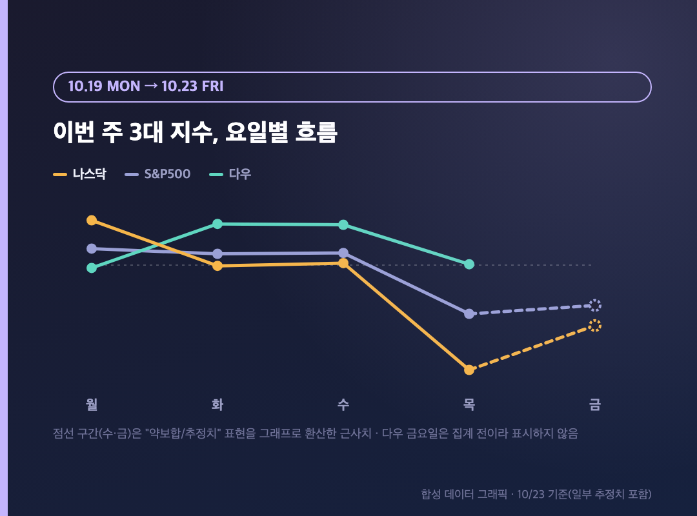
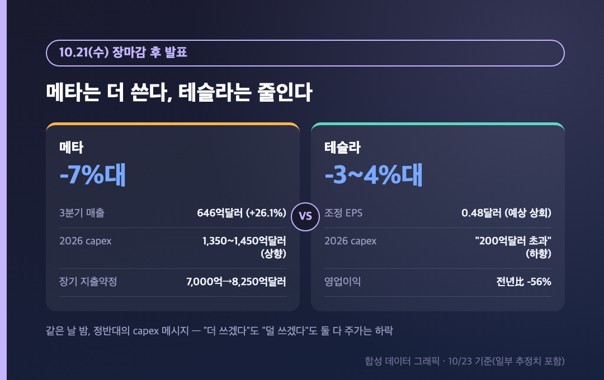
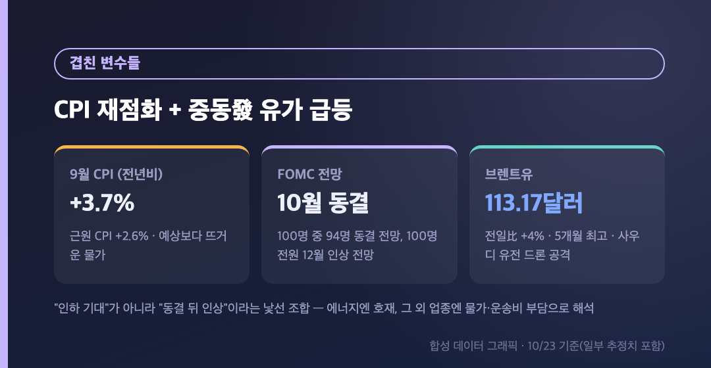
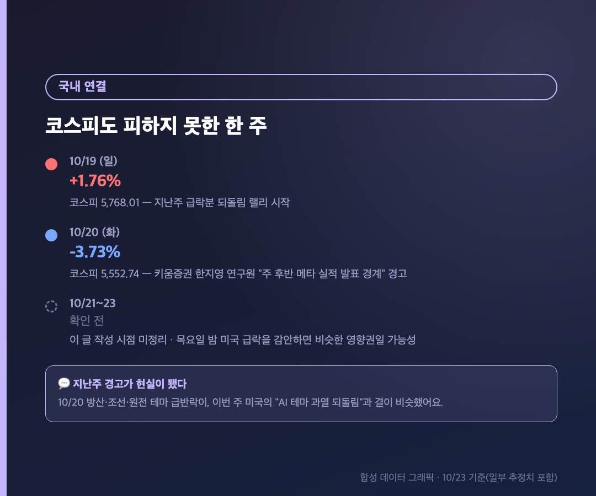
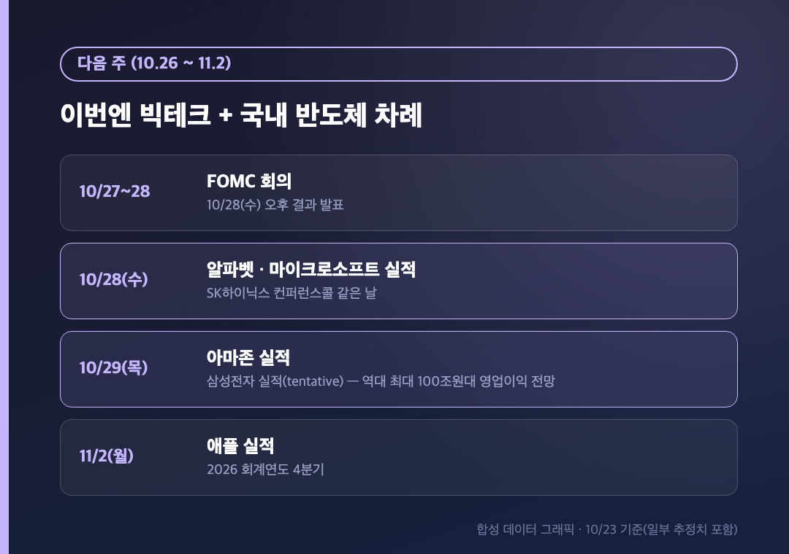

# [내일도 주린이] 나스닥 주간 -4.5%, 6월 이후 최악의 한 주…메타·테슬라가 가른 이번주 미장 이슈 정리 (10/19~10/23)

나스닥 주간 -4.5%. 6월 이후로 가장 안 좋았던 한 주였습니다.

오늘은 평소 하루치 국장·미장 정리가 아니라, 이번 주(10/19 월~10/23 금) 미국 증시를 통째로 묶어서 정리하는 "주간 미장 이슈 정리"예요. 하루씩 보면 오르고 내리고 정신없었는데, 한 주로 묶어보니 흐름이 꽤 선명하게 보이더라고요.

---

## 📅 이번 주 지수 리캡 – 월~수 반등, 목~금 재급락

> **나스닥 주간 약 -4.5% / S&P500 주간 약 -1.9% / 다우 주간 +0.7%**

| 요일 | 나스닥 | S&P500 | 다우 |
|---|---|---|---|
| 월(10/19) | +1.11% (26,430.89) | +0.41% (7,690.73) | -0.07% (51,966.03) |
| 화(10/20) | -0.02% (26,424.82) | +0.28% (7,712.57) | +1.02% (52,495.88) |
| 수(10/21) | 약보합 | 약 +0.3% | 약 +1%대 |
| 목(10/22) | -2.60% | -1.21% (7,663.43) | +0.02% |
| 금(10/23) | 추가 하락(약 -1~2%대) | 약세 | 집계 전 |

월요일부터 수요일까지는 지난주(10/13~10/16) 반도체·AI주 급락분을 되돌리는 랠리였어요. 그런데 수요일 장마감 후 메타·테슬라 실적이 나오면서 분위기가 통째로 뒤집혔습니다. 목요일 나스닥 -2.6%는 올해 6월 이후 최대 하루 하락폭이었고, 금요일까지 약세가 이어지면서 결국 주간으로는 나스닥·S&P500이 빠지고 다우만 혼자 올랐어요. 다우가 기술주 비중이 낮다는 걸 이번 주처럼 체감한 적이 없었습니다.

---

## 💥 메타 vs 테슬라 – 같은 날 밤, 정반대의 capex 메시지

> **메타 -7%대 (capex 1,350억~1,450억달러로 상향) / 테슬라 -3~4%대 (capex "200억달러 초과"로 하향)**

| 항목 | 메타 | 테슬라 |
|---|---|---|
| 발표 시점 | 10/21(수) 장마감 후 | 10/21(수) 장마감 후 |
| 3분기 실적 | 매출 646억달러(전년比 +26.1%), 가이던스 상회 | 매출 280.5억달러, 조정 EPS 0.48달러(예상 0.43달러 상회) |
| 2026 capex 가이던스 | 1,350억~1,450억달러로 상향(기존 하단 1,300억달러) | "250억달러 초과"→"200억달러 초과"로 하향 |
| 추가 공개 | 장기 지출 약정 7,000억→8,250억달러, 비상장주식 발행 계획 | 영업이익 전년比 -56%, 자유현금흐름 -62% |
| 목요일 주가 | -7%대(종가 약 648.85달러) | 약 -3~4%대 |

실적만 보면 둘 다 잘 나왔어요. 그런데 시장이 반응한 건 숫자가 아니라 "앞으로 돈을 얼마나 쓸 거냐"였습니다. 메타는 쓰겠다고 했고(그래서 돈 걱정), 테슬라는 줄이겠다고 했고(그래서 성장 걱정) — 결국 양쪽 다 주가가 빠졌어요. "어느 쪽이 맞는 답이냐"를 시장이 아직 못 정한 한 주였다고 보면 될 것 같습니다. 여기에 나스닥 -2.6%, 필라델피아 반도체지수는 -6.7%(6/23 이후 최대 하락)까지 겹치면서 목요일이 이번 주의 진짜 변곡점이 됐어요.

엔비디아도 수요일 +2.5%였다가 목요일 -4.4%로 반락했는데, 같은 날 독일 GTC 베를린에서 'DSX POD' AI 팩토리 설계를 공개하고 이비덴·삼성전기 등 6개 협력사와 2028년까지 공급망 확장 계약을 발표한 건 거의 묻혔습니다. 좋은 뉴스도 업종 전체 매도 압력 앞에서는 힘을 못 썼어요.

---

## 🌡️ CPI 재점화 + 중동 유가 급등 – 겹친 변수들

> **9월 CPI 전년비 +3.7% / FOMC(10/28) 동결 전망 94% / 브렌트유 +4%, 113.17달러**

| 지표 | 수치 | 의미 |
|---|---|---|
| 9월 CPI(전년비) | +3.7% (근원 +2.6%) | 예상보다 뜨거워 "끈적한 인플레이션" 우려 |
| FOMC 전망(로이터 설문) | 100명 중 94명 "10월 동결", 100명 전원 "12월 인상" | 금리 인하 기대가 아니라 동결 뒤 인상이라는 낯선 조합 |
| 브렌트유 | 전일比 +4%, 배럴당 113.17달러(5개월 최고) | 사우디 유전·공항 후티 공격發 지정학 리스크 |

목요일 사우디아라비아 샤이바 유전과 담맘 공항이 후티 드론 공격을 받으면서 유가가 하루 만에 4% 뛰었어요. 에너지 섹터엔 호재였지만 그 외 업종엔 "물가 자극 + 운송비 부담"으로 읽혀서 기술주 매도 분위기에 숟가락을 더했습니다. 여기에 다음 주 FOMC(10/27~28)를 앞두고 "10월엔 쉬고 12월에 올린다"는 컨센서스까지 겹치니, 이번 주 시장은 금리 인하를 기다리는 게 아니라 거의 반대 상황과 씨름하고 있었던 셈이에요.

---

## 🇰🇷 국내 연결 – 지난주 국장정리에서 이미 나온 경고가 현실이 됐어요

> **10/19 코스피 +1.76%(5,768.01) / 10/20 코스피 -3.73%(5,552.74)**

지난주 10/20 국장정리에 적어뒀던 걸 다시 꺼내볼게요. 키움증권 한지영 연구원이 코스피 급락 원인 중 하나로 "주 후반 메타 실적 발표 경계"를 명시적으로 언급했었는데, 이번 주 미국 시장이 겪은 걸 보면 그 경계가 그대로 현실이 됐습니다. 국내에서도 10/20에 방산·조선·원전 같은 전일 급등 테마가 가장 크게 반락했었는데, 이번 주 미국의 "AI 테마 과열 되돌림"과 결이 비슷해요.

10/21~23 국장 상황은 이 글 쓰는 시점엔 따로 정리가 안 된 상태라 직접 비교는 못 했지만, 목요일 밤 미국 시장이 이렇게 흔들린 걸 감안하면 국내도 비슷한 방향으로 영향을 받았을 가능성이 높아 보입니다. 제 삼성전자 25주 입장에서는, 이번 주 메타·테슬라가 흔든 건 "반도체 수요" 얘기가 아니라 "AI 지출 방향성" 얘기였다는 점을 기억해두려고요.

---

## 🔮 다음 주(10/26~10/30) 전망 – FOMC, 그리고 삼성전자·SK하이닉스 차례

> **FOMC 10/28(수) 결과 발표 / 알파벳·MS 10/28, 아마존 10/29 실적 / SK하이닉스 10/28, 삼성전자 10/29(tentative)**

| 날짜 | 이벤트 |
|---|---|
| 10/27~28(화~수) | FOMC 회의, 10/28(수) 오후 결과 발표 |
| 10/28(수) | 알파벳·마이크로소프트 실적 발표, SK하이닉스 콘퍼런스콜 |
| 10/29(목) | 아마존 실적 발표, 삼성전자 실적(tentative) |
| 11/2(월) | 애플 2026 회계연도 4분기 실적 발표 |

이번 주가 메타·테슬라였다면 다음 주는 알파벳·마이크로소프트·아마존 차례예요. 관전 포인트는 하나입니다 — 이 셋도 메타처럼 "AI에 더 쓰겠다"고 할지, 아니면 테슬라처럼 속도조절 신호를 줄지. 투자 늘리면 비용 걱정, 줄이면 성장 걱정이라 어느 쪽이든 쉽지 않다는 평가가 많더라고요.

국내 쪽은 SK하이닉스가 10/28, 삼성전자가 10/29(tentative)로 예정돼 있어요. 삼성전자는 역대 최대인 100조원대 영업이익이 나올 거라는 전망까지 있는 상황이라, 제 25주 입장에서는 이번 주보다 다음 주가 훨씬 중요한 한 주가 될 것 같습니다.

---

## 마무리하며

한 줄로 정리하면, 월~수는 되돌림 랠리, 목~금은 메타·테슬라발 AI 지출 논쟁으로 재급락 — 그래서 나스닥 -4.5%, S&P500 -1.9%, 다우만 +0.7%로 한 주가 끝났어요.

같은 실적 시즌인데 "더 쓴다"와 "덜 쓴다"가 둘 다 주가를 떨어뜨리는 걸 보면서, AI 투자에 대한 시장의 기준이 아직 안 잡혀 있다는 생각이 들었습니다. 다음 주 FOMC랑 알파벳·마이크로소프트·아마존·삼성전자 실적 보면서 그 기준이 좀 더 분명해지는지 지켜볼게요 👀
