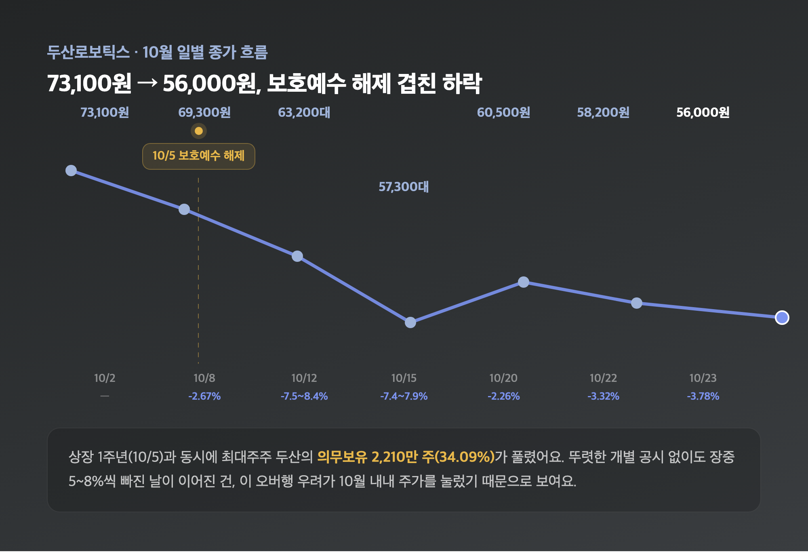
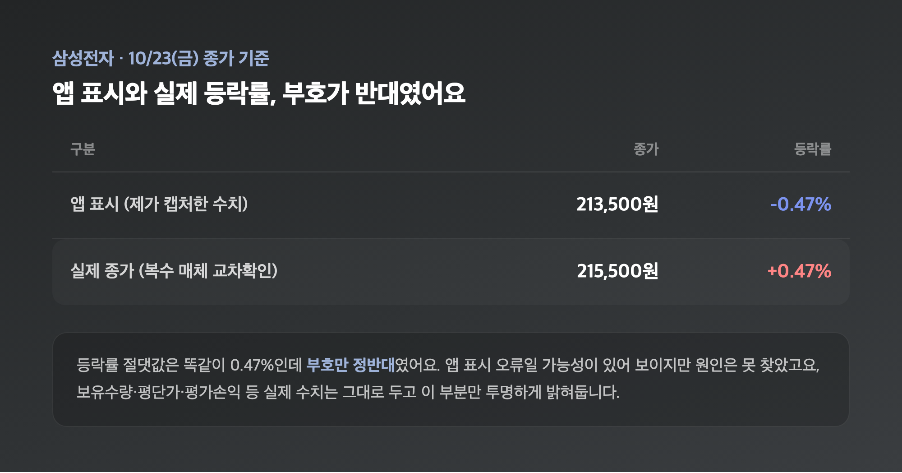
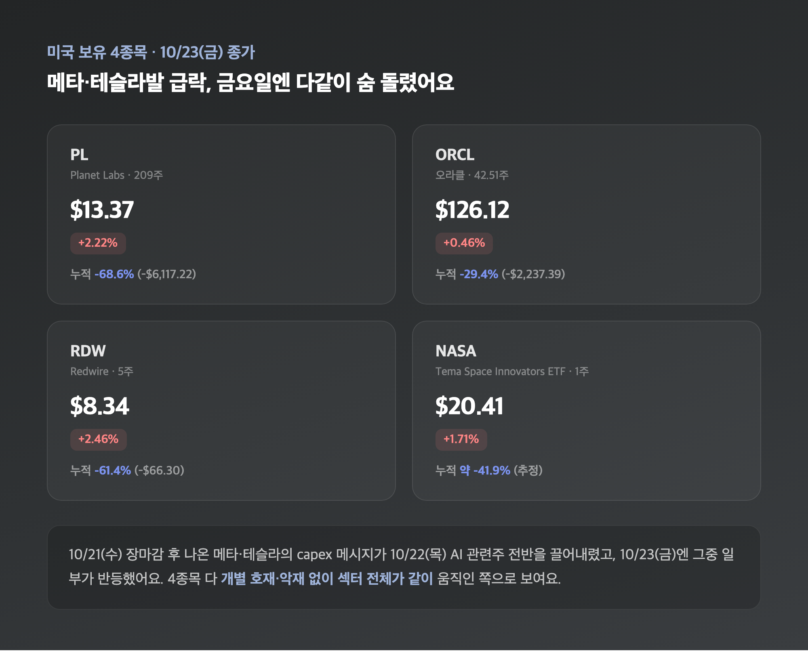
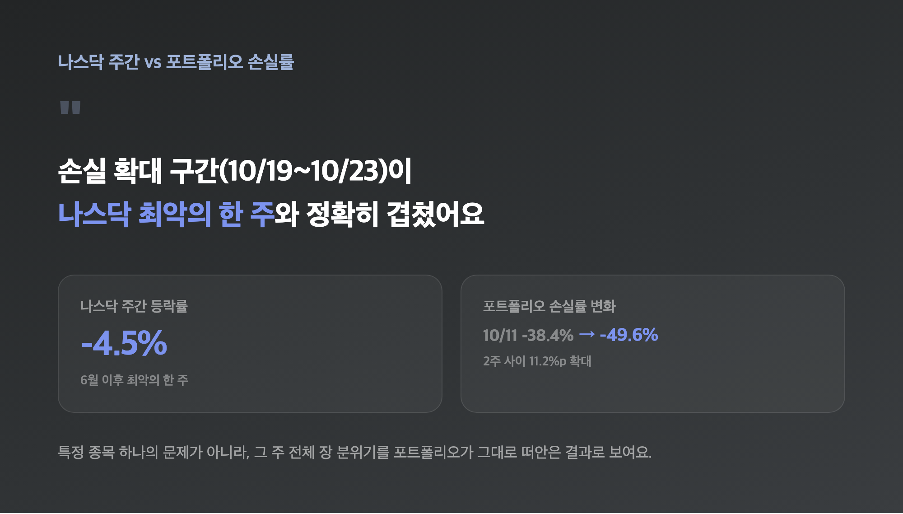
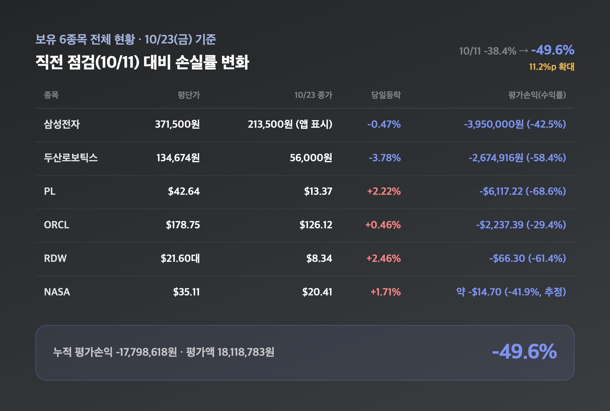

# [내일도 주린이] 포트폴리오 점검, -49.6%로 확대…두산로보틱스 보호예수 해제 겹쳐 (10/25)

-38.4%에서 -49.6%. 2주 사이에 전체 손실률이 이렇게 벌어졌어요. 오늘은 평소보다 숫자 하나하나가 더 무겁게 느껴지는 포트폴리오 점검이라, 에둘러 가지 않고 바로 실보유 6종목부터 짚어볼게요.

---

## 🤖 두산로보틱스 — 보호예수 해제가 두 자릿수 하락을 만들었어요

> **두산로보틱스 ₩56,000 (-3.78%) / 평단 134,674원 대비 -58.4% (평가손익 -2,674,916원)**

| 날짜 | 종가 | 등락 |
|---|---|---|
| 10/2 (금) | 73,100원 | — |
| 10/8 (목) | 69,300원 | -2.67% |
| 10/12 (월) | 63,200~63,800원대 | -7.5~8.4% |
| 10/15 (수) | 57,300~57,600원대 | -7.4~7.9% |
| 10/20 (화) | 60,500원 | -2.26% |
| 10/22 (목) | 58,200원 | -3.32% |
| 10/23 (금) | 56,000원 | -3.78% |

직전 점검(10/11)에서 73,100원이었던 두산로보틱스가 2주 만에 56,000원대까지 내려왔어요. 23~24% 추가 하락인데, 이번엔 원인이 꽤 뚜렷합니다. 10/5가 두산로보틱스 상장 1주년이었고, 그날로 최대주주 두산이 들고 있던 2,210만 주(발행주식의 34.09%)의 의무보유등록이 풀렸어요. 34주 들고 있는 제 입장에서는 "전체 주식의 3분의 1이 넘는 물량이 한꺼번에 팔 수 있게 됐다"는 오버행 우려 하나가, 10월 한 달 내내 주가를 눌러온 셈이더라고요. 10/12 전후엔 뚜렷한 개별 공시도 없이 장중 5~8%씩 빠진 날이 여러 번 있었는데, 그게 다 이 보호예수 해제 우려와 로봇 섹터 전반의 밸류에이션 부담이 겹친 결과로 보여요. 같은 기간 레인보우로보틱스 등 다른 로봇주들도 동반 약세였다고 하니, 두산로보틱스만의 개별 이슈는 아니었던 걸로 보입니다.

---

## 🇰🇷 삼성전자 — 앱 수치가 실제와 부호까지 반대였어요, 10/29 실적발표가 다음 변수

> **삼성전자 ₩213,500 (-0.47%, 앱 표시) / 평단 371,500원 대비 -42.5% (평가손익 -3,950,000원)**

| 구분 | 종가 | 등락률 |
|---|---|---|
| 앱 표시 (제가 캡처한 수치) | 213,500원 | -0.47% |
| 실제 10/23 종가 (복수 매체 교차확인) | 215,500원 | +0.47% |

짧게 짚어두고 갈 게 있어요. 제 앱엔 213,500원 -0.47%로 찍혀 있는데, 복수 매체가 확인한 10/23 실제 종가는 215,500원 +0.47%였습니다. 등락률 절댓값은 똑같이 0.47%인데 부호만 정반대인 거라, 앱 표시 오류일 가능성이 있어 보여요(원인은 못 찾았습니다). 보유수량·평단가·평가손익 같은 실제 수치는 그대로 두고(25주, 평단 371,500원, -3,950,000원, -42.5%) 이 부분만 투명하게 밝혀둡니다. 10/23 당일은 장중 5% 넘게 급락했다가 오후에 반등해서 +0.47%로 마감한, 변동성이 컸던 하루였다고 해요. 다음 변수는 10/29(목) 삼성전자 3분기 확정 실적발표예요. 10/8 잠정실적에서 영업이익 107조 4,000억원(영업이익률 55.1%)으로 국내 기업 최초 단일 분기 100조 돌파를 이미 찍었으니, 사업부문별 세부 내역과 4분기 가이던스가 어떻게 나오는지가 관심사입니다.

---

## 🛰️ PL·ORCL·RDW·NASA — 메타·테슬라발 급락, 금요일엔 다같이 숨 돌렸어요

> **PL $13.37 (+2.22%) / ORCL $126.12 (+0.46%) / RDW $8.34 (+2.46%) / NASA $20.41 (+1.71%)**

지난주 미장 정리 글에서 이미 다룬 얘기인데, 10/21(수) 장마감 후 나온 메타·테슬라의 capex 메시지가 10/22(목) AI 관련주 전반을 끌어내렸고, 금요일(10/23)엔 그중 일부가 반등했어요. 제 보유 4종목도 정확히 이 흐름을 그대로 탔습니다.

| 종목 | 보유수량 | 평단가 | 10/23 종가 | 당일등락 | 평가손익(수익률) |
|---|---|---|---|---|---|
| PL (Planet Labs) | 209주 | $42.64 | $13.37 | +2.22% | -$6,117.22 (-68.6%) |
| ORCL (오라클) | 42.51주 | $178.75 | $126.12 | +0.46% | -$2,237.39 (-29.4%) |
| RDW (Redwire) | 5주 | $21.60대 | $8.34 | +2.46% | -$66.30 (-61.4%) |
| NASA (Tema Space Innovators ETF) | 1주 | $35.11 | $20.41 | +1.71% | 약 -$14.70 (-41.9%, 추정) |

4종목 다 개별 호재·악재 기사는 따로 확인되지 않았고, 섹터 전체가 같이 움직인 쪽으로 보여요. 실제 10/23 종가는 PL $13.41(+2.52%), ORCL $126.16(+0.49%), RDW $8.36(+2.70%)로 교차확인됐는데, 제 앱 수치와는 소폭 차이만 있을 뿐 방향은 전부 같았습니다. NASA는 정규장 $20.39(+1.59%)에 애프터마켓까지 더해 $20.41로 마감했어요. 이번엔 NASA의 평가손익·손익률을 따로 안 적어뒀길래, 평단가 대비로 역산한 추정치를 표에 넣었습니다 — 확정 수치는 아니라는 점 밝혀둡니다. PL은 -68.6%까지 와서 52주 고점 대비로는 거의 4분의 3이 날아간 수준인데, 209주라는 보유수량이 있다 보니 숫자가 유독 크게 느껴지네요.

---

## 📉 나스닥 주간 -4.5% — 손실 확대 시점과 정확히 겹쳐요

> **나스닥 주간 약 -4.5% (6월 이후 최악의 한 주) / 손실률 10/11 -38.4% → 10/25 -49.6%**

10/19~10/23, 딱 이 손실 확대 구간에 나스닥이 주간 기준 -4.5%(6월 이후 최악의 한 주)를 찍었어요. 메타·테슬라의 AI 지출 확대 메시지가 불씨였다는 건 위에서 말씀드린 그대로고요. 시기가 이렇게 맞아떨어지는 걸 보면, 이번 손실 확대가 특정 종목 하나의 문제가 아니라 그 주 전체 장 분위기를 포트폴리오가 그대로 떠안은 결과라는 생각이 듭니다.

---

## 📊 보유 6종목 전체 총정리 — 누적 -49.6%, 직전보다 11.2%p 더 벌어졌어요

> **누적 평가손익 -17,798,618원 / 평가액 18,118,783원 / 전체 수익률 -49.6%**

| 종목 | 보유수량 | 평단가 | 10/23 종가 | 당일등락 | 평가손익(수익률) |
|---|---|---|---|---|---|
| 삼성전자 | 25주 | 371,500원 | 213,500원(앱 표시) | -0.47% | -3,950,000원 (-42.5%) |
| 두산로보틱스 | 34주 | 134,674원 | 56,000원 | -3.78% | -2,674,916원 (-58.4%) |
| PL (Planet Labs) | 209주 | $42.64 | $13.37 | +2.22% | -$6,117.22 (-68.6%) |
| ORCL (오라클) | 42.51주 | $178.75 | $126.12 | +0.46% | -$2,237.39 (-29.4%) |
| RDW (Redwire) | 5주 | $21.60대 | $8.34 | +2.46% | -$66.30 (-61.4%) |
| NASA (Tema Space Innovators ETF) | 1주 | $35.11 | $20.41 | +1.71% | 약 -$14.70 (-41.9%, 추정) |

여섯 종목 다 더하면 평가액 18,118,783원에 누적 평가손익 -17,798,618원, 전체 수익률 -49.6%예요. 직전 점검(10/11)이 -38.4%였으니 11.2%p나 더 벌어진 거고, 금액으로는 약 387만 원이 2주 사이에 더 깎였습니다. 참고로 제 앱엔 "보유 5건"으로 떠서 NASA가 집계에서 빠졌을 가능성도 있는데, NASA는 제가 여전히 보유 중인 종목이라 이번 포트폴리오 점검에는 6개 다 넣었어요 — 그래서 위 전체 수익률 숫자에 NASA가 정확히 어떻게 반영돼 있는지는 저도 100% 확신하지는 못합니다.

---

## 마무리하며

-38.4%에서 -49.6%. 숫자로만 보면 2주 만에 또 한 번 크게 밀린 구간이에요. 두산로보틱스는 보호예수 해제라는 뚜렷한 이유가 있었고, 나머지 4종목은 그 주 전체 장이 안 좋았던 영향을 그대로 받았습니다. 당장 뭘 바꿀 계획은 없고요, 다음 점검 전까지 볼 건 딱 두 개예요 — 10/29 삼성전자 실적발표, 그리고 두산로보틱스 보호예수 물량이 실제로 더 풀리는지.

#포트폴리오점검 #내주식포트폴리오 #두산로보틱스 #보호예수해제
