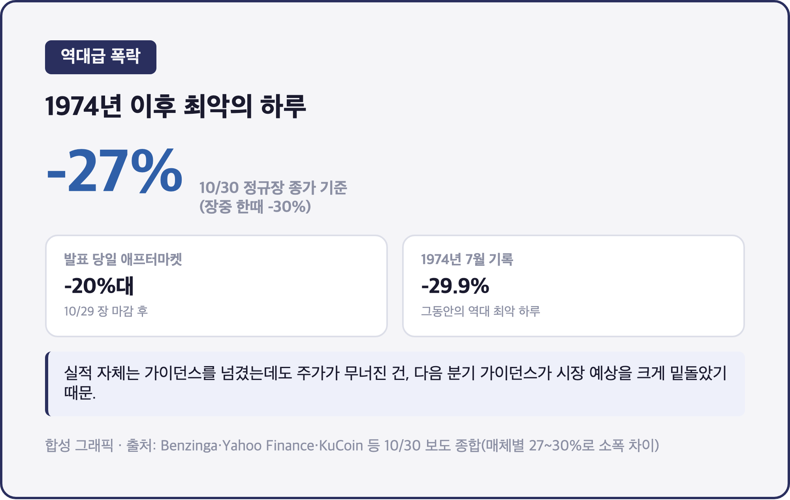
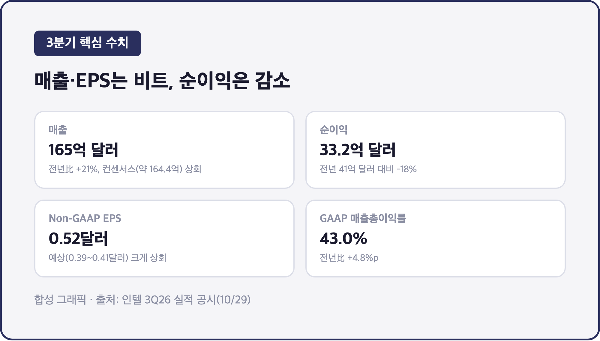
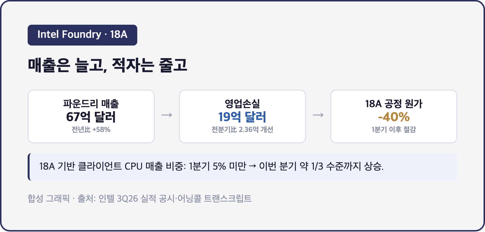
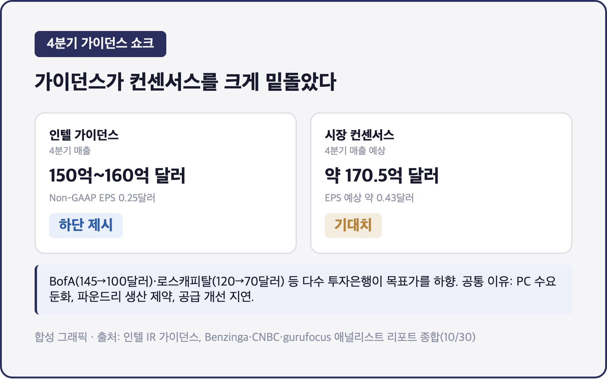

# [내일도 주린이] 인텔 3분기 실적은 기대 이상, 그런데 주가는 1974년 이후 최악의 폭락 (10/31)

-27%. 하루 만에 이만큼 빠진 거, 인텔 역사에서 1974년 이후 처음이라고 해요.

재밌는 건 이게 "실적이 망해서"가 아니라는 거예요. 매출도 늘고 EPS도 가이던스를 넘겼는데, 다음날 주가가 반세기 만에 최악의 하루를 보냈습니다. 저는 인텔 주식은 안 들고 있는데요, 삼성전자(파운드리 경쟁사)·SK하이닉스(메모리)를 들고 있어서 "PC 수요 둔화"랑 "파운드리 영업손실 19억 달러" 같은 숫자가 그냥 남 얘기로는 안 읽히더라고요. 숫자부터 하나씩 짚어볼게요.

인텔은 현지시간 10/29(목) 장 마감 후 2026 회계연도 3분기(7~9월) 실적을 발표했고, 다음날인 10/30(금) 정규장에서 주가가 무너졌어요. (인텔은 회계연도가 캘린더 연도와 같아서 "3분기"라는 표현이 실제 7~9월 실적을 그대로 가리킵니다.)

---

## 💥 역대급 폭락 그 자체 – 1974년 이후 최악의 하루

> **10/30 정규장 종가 기준 약 -27% / 장중 한때 -30% / BofA·로스캐피탈 등 투자은행 잇달아 목표가 하향**

발표 당일 애프터마켓에서 20%대로 미끄러지더니, 다음날 정규장에서는 프리마켓부터 25~26%대로 출발했어요. 장중엔 한때 -30%까지 찍었다가 종가는 -27% 선에서 마감됐다고 해요(매체별로 장중 저점 기준이냐 종가 기준이냐에 따라 27~30%로 숫자가 조금씩 다르게 나와요). 1974년 7월 -29.9%가 그동안 역대 최악 하루였는데, 이번에 거의 그 기록에 다시 닿을 뻔한 거죠.

실적 발표 자체는 "비트(beat)"였는데 주가가 이렇게 무너진 건, 다음에 나올 4분기 가이던스가 생각보다 훨씬 약했기 때문이에요. 좋은 성적표를 받고도 다음 학기 계획표가 더 크게 흔들어놓은 셈이랄까요.

---

## 📊 3분기는 사실 나쁘지 않았어요 – 매출 21% 증가, EPS도 상회

> **매출 165억 달러 (전년比 +21%) / 순이익 33.2억 달러 (전년比 -18%) / Non-GAAP EPS 0.52달러 (예상 0.39~0.41달러 상회)**

| 항목 | 3분기 실적 | 전년 동기 | 비교 |
|---|---|---|---|
| 매출 | 165억 달러 | - | +21%, 컨센서스(약 164.4억 달러) 상회 |
| 순이익 | 33.2억 달러 | 41억 달러 | -18%(매출은 늘었는데 순이익은 줄었어요) |
| GAAP EPS | 0.60달러 | - | - |
| Non-GAAP EPS | 0.52달러 | - | 예상치(0.39~0.41달러)를 크게 상회 |
| GAAP 매출총이익률 | 43.0% | 38.2% | +4.8%p |
| GAAP 영업이익률 | 15.3% | 5.0% | +10.3%p |

CFO 데이비드 진스너는 "매출, 매출총이익률, EPS 모두 가이던스를 넘겼고, 특히 15년 만에 가장 강력한 데이터센터 매출 성장을 기록했다"고 밝혔어요. 사업부별로 보면 데이터센터·AI(DCAI) 매출이 73억 달러로 전년比 +78% 뛰었고, 반대로 PC 쪽인 CCPG는 81억 달러로 -5%였어요. 순이익이 줄어든 배경은 리서치에서 따로 확인되진 않았지만, 파운드리 쪽 적자가 여전한 걸 보면 그 영향이 있었을 걸로 보여요.

---

## 🏭 파운드리는 아직 적자, 18A는 확실히 좋아지고 있어요

> **Intel Foundry 매출 67억 달러 (전년比 +58%) / 영업손실 19억 달러 (전분기比 2.36억 달러 개선) / 18A 공정 원가 1분기 이후 40% 절감**

삼성전자도 파운드리 사업을 하고 있어서 저는 이 숫자를 좀 다르게 보게 되는데요, 매출은 58%나 늘었는데 영업손실은 아직 19억 달러예요. 가동률이 오르면서 전분기보다는 2.36억 달러 개선됐다고 하니 방향 자체는 나쁘지 않아요. 18A 공정은 1분기엔 클라이언트 CPU 매출의 5% 미만이었는데 이번 분기엔 1/3 수준까지 올라왔고, 수율도 두 자릿수 비율로 개선 중이라고 해요.

첫 18A 기반 서버 제품인 Clearwater Forest는 이미 매출로 인식되는 단계까지 왔고, 2027년 "에이전틱 랙스케일" 수요가 많다고 언급했어요. 외부 파운드리 고객 쪽은 "몇몇 전략적으로 중요한 고객"과 협의 중이라는데, 구체적으로 누구인지는 밝히지 않았습니다. 삼성전자 파운드리 입장에서는 경쟁자가 조금씩 자리를 잡아가는 모습으로 보일 것 같아요.

---

## 🔮 문제는 4분기 가이던스 – 컨센서스와 너무 크게 벌어졌어요

> **4분기 매출 가이던스 150억~160억 달러 (컨센서스 약 170.5억 달러 하회) / Non-GAAP EPS 가이던스 0.25달러 (컨센서스 약 0.43달러 하회)**

여기가 진짜 문제였어요. 매출 가이던스 상단(160억 달러)조차 시장이 보던 하단에도 못 미쳤고, EPS 가이던스는 컨센서스의 절반 수준이었거든요. CEO 립부 탄은 "우리 CPU 수요는 견조하다"고 했지만, 시장이 본 건 PC 수요 둔화와 파운드리 생산 제약, 공급 개선 지연이었던 것 같아요. 가이던스 매출총이익률도 37.1%(GAAP)로 3분기 43.0%보다 뚝 떨어지는 그림이었고요.

BofA증권은 매수에서 중립으로 내리면서 목표가를 145달러에서 100달러로, 로스캐피탈은 120달러에서 70달러로 낮췄어요. 제프리스·UBS·파이퍼 샌들러도 전부 목표가를 10~20% 안팎 깎았고요. 공통된 이유는 PC 수요 약세, 생산 제약, 공급 개선 지연이었습니다.

---

## 마무리하며

3분기 매출 165억 달러(+21%)는 비트였는데, 4분기 가이던스가 시장 기대를 크게 밑돌면서 주가가 하루에 27% 날아갔어요. 1974년 이후 최악의 하루였다고 하니, 숫자로는 실감이 잘 안 될 정도네요.

삼성전자 파운드리와 SK하이닉스 메모리를 들고 있는 입장에서는, 인텔 18A가 느리지만 꾸준히 좋아지고 있다는 점과 PC 수요 둔화가 메모리 쪽에 어떤 영향을 줄지가 다음에 챙겨볼 포인트예요. 가이던스 발표 하나로 이렇게까지 갈릴 수 있다는 걸 다시 한번 본 하루였습니다 😮‍💨
